# CC-NIC 不需要硬件缓存一致性：商用 PCIe 网卡 DirectPush 全量实验总报告

> **一句话核心论点（*CC-NIC does not need Cache Coherence*）**
> 高速网卡的亚微秒延迟、低主机核占用与低内存污染，**来自「把数据直接推入读者缓存、本地轮询、在途信用流控、大小包分工、主动网卡蓄水」这套接口与数据面设计，而不是来自 CXL.cache / UPI 一类的硬件缓存一致性互连**。仅用现成商用 PCIe Gen5×4 网卡（`Marvell OCTEON 10 CN106`，全程开启硬件 `IOMMU`、**零硬件缓存一致性、零 Intel DSA**），经过 **22 项核心实测、3,990 轮归档日志**（累计验证超过 **35 亿条**消息/以太网帧，`bad = torn = 0`），我们在真实双机 `100GbE` 网线上跑出了 **`0.885–0.898 µs`** 单机往返（胜真实 CXL 1.1 硬件网卡 `CXL-NIC` 的 `~1.3–2.1 µs` 与同卡公平 `SDP` `5.24×`）、**`0.935 µs`** 双机 `100GbE` 主机⇄网卡增量（端到端 **`5.285 µs`**）、**`1 核主机`** 单向收发小包近倍领先同卡最优 `SDP` 并跑满/逼近 `100GbE` 线速、以及 **`−98.90%`** 突发场景主机 DRAM 流量卸载。

**文档定位与口径声明**：本报告是 `CC-NIC` 系列全部实验的**唯一终版总报告**，按论文论证主线统一重排为 **一页总览 + 7 章**，所有核心数字均直接从仓库 `logs/mrv*/runs*.jsonl` 原始日志重新核验，**全面吸收 `MRV-37` 独立评审后收紧的全部边界，并彻底清除了早期报告中已撤回或含水分的口径**（详见第 7 章对照清单）。

---

## 目录

- [一页总览与全量实验证据速查表](#一页总览与全量实验证据速查表)
- [第 1 章 打破前提与保序：为什么普通 PCIe 也能亚微秒与满线速](#第-1-章-打破前提与保序为什么普通-pcie-也能亚微秒与满线速)
- [第 2 章 发送缓冲与零一致性税：无损直推原地复用与 128 MiB 留存池](#第-2-章-发送缓冲与零一致性税无损直推原地复用与-128-mib-留存池)
- [第 3 章 高并发拥塞与流控：单写单读踩写前沿冲撞与主机信用限流](#第-3-章-高并发拥塞与流控单写单读踩写前沿冲撞与主机信用限流)
- [第 4 章 完整接口 DirectPush 与挤干水分的公平省核账本](#第-4-章-完整接口-directpush-与挤干水分的公平省核账本)
- [第 5 章 真实双机 100GbE 端到端全量验证（延迟 + 双向 + 单向 TX + 单向 RX）](#第-5-章-真实双机-100gbe-端到端全量验证延迟--双向--单向-tx--单向-rx)
- [第 6 章 主动网卡突发缓冲：主机只留 256 KiB 热环，突发留卡 L3 / DDR5](#第-6-章-主动网卡突发缓冲主机只留-256-kib-热环突发留卡-l3--ddr5)
- [第 7 章 诚实边界、已撤回/收紧口径清单与剩余可选 Backlog 地图](#第-7-章-诚实边界已撤回收紧口径清单与剩余可选-backlog-地图)

---

## 一页总览与全量实验证据速查表

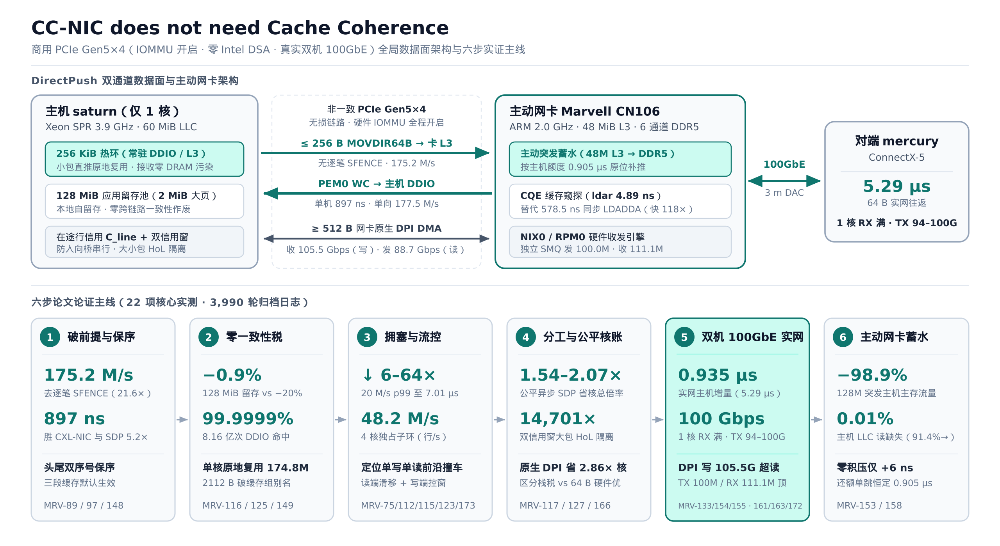

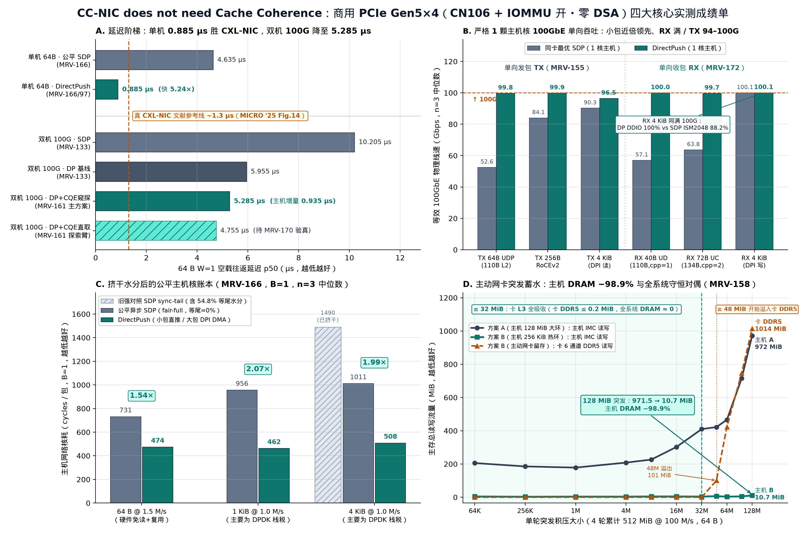

### 固定硬件平台与实验纪律（全套实验统一底座）

| 组件 | 硬件与固定配置 | 说明 |
| :--- | :--- | :--- |
| **主机 `saturn`** | Intel Xeon Gold 6438M（Sapphire Rapids），`60 MiB` LLC，Socket-1 `cpu40` 锁频 `3.90 GHz`（`performance`），Uncore 锁 `2.20 GHz` | 全程 `intel_iommu=on,sm_on`（硬件 IOMMU 开启），使用 Node 1 `2 MiB` 大页（`page_faults = 0`），**零 Intel DSA** |
| **主动网卡 `CN106`** | Marvell OCTEON 10 `crb106-pcie`，PCIe Gen5×4（单向理论 `15.75 GB/s`，`64 B` 事务上限 `179.02 M/s`），24 核 ARM Neoverse-N2 `@ 2.00 GHz`（实读 `rclk = 2000 MHz`、`sclk = 1000 MHz`），`48 MiB` L3，6 通道 DDR5 | BAR4 窗口受 [MRV-26 BAR4 安全租约握手](https://linear.app/taooceros/issue/MRV-26) 保护；回程使用 `PEM0 WC` 写合并与原生 `DPI DMA`（`06:00.1..4` 四 VF）；同卡基线 `SDP` 为官方 `octeon_ep` VF 队列 |
| **对端机 `mercury`** | 128 核 Xeon + Mellanox ConnectX-5（`mlx5_2`，PCIe Gen3×16），经 `3 m` 无源 `100GbE` 铜缆（No-FEC DAC）直连 CN106 物理网口 `eth0` | 真实双机 `100GbE` 端到端链路；第 5 章全部网络实测经此真实物理网线完成 |
| **实验与验真纪律** | 严格区分 `batch`（每次门铃提交包数）与 `W`（并发窗口，同时在途请求数）；全量数据逐包校验 `seq + cookie + 尾镜像`；双端 PMU `100%` 非复用；遵循 [MRV-82 奥卡姆剃刀单变量原则](https://linear.app/taooceros/issue/MRV-82) | 22 项核心实测共 3,990 轮归档日志（其中 3,984 轮严格全零丢包/零错/零撕裂；仅 [MRV-155 1核100GbE单向TX与双向](https://linear.app/taooceros/issue/MRV-155) Phase 2 有 6 轮非隔离对端 `mercury` CX5 RX 缓冲极微溢出 `0.001%–0.039%`，主机与 CN106 零错零丢）；全周期 `EDAC UE = 0`、`SEI-UER = 0` |

### 七大核心主张与全量实测证据速查表

| # | 论文核心主张 | 关键实测数字（均自原始日志复算） | 关键前提与诚实边界 | 精确 Linear 议题 |
| :-: | :--- | :--- | :--- | :--- |
| **1** | **推翻前提 + 亚微秒与保序**：PCIe 直写不慢，慢的是逐笔 `SFENCE`；两端三段缓存默认生效，原子 `64 B` + 头尾双序号保序零撕裂 | • 单核 `MOVDIR64B` `batch=1`：每笔 `SFENCE` `8.10 M/s` → 去逐笔 `SFENCE` **`175.20 M/s`**（`21.6×`，`97.9%` 线速） • `64 B W=1` 往返：**`897–898 ns`**（[MRV-97 W=1三段缓存与897ns](https://linear.app/taooceros/issue/MRV-97)）/ **`885 ns`**（[MRV-166 异步等尾公平SDP核账本](https://linear.app/taooceros/issue/MRV-166)），快于同卡公平 `SDP`（`4.635 µs`，**`5.24×`**）与真 CXL 1.1 `CXL-NIC`（`~1.3–2.1 µs`） • 三段缓存收益：发端 L1D `117.3 ns`、卡 L3 `75.0 ns`（命中 `99.94%`）、主机 DDIO `87.3 ns` | 裸互连物理上无法超越双路 CPU UPI 仿真的 `490/650 ns` 或 56 核 `1.52 Gpps`；`MOVDIR64B` 跨行弱保序，靠接收端严格按序 + 头尾双序号兜底（实测零撕裂非硬件跨行强序保证） | [MRV-89 MOVDIR64B去SFENCE满线速](https://linear.app/taooceros/issue/MRV-89)、[MRV-97 W=1三段缓存与897ns](https://linear.app/taooceros/issue/MRV-97)、[MRV-148 阶段报告1/5前提与保序](https://linear.app/taooceros/issue/MRV-148)、[MRV-22 开环极限与原生DPI](https://linear.app/taooceros/issue/MRV-22)、[MRV-26 BAR4安全租约握手](https://linear.app/taooceros/issue/MRV-26) |
| **2** | **发送缓冲原地复用与零一致性税**：无损 PCIe 直推下小包推完即复用；上层自留存 `128 MiB` 池网卡侧零作废税 | • 单核覆写同一 `64 B` 缓冲直推：**`174.84 M/s`**（`97.7%` 线速） • 顺序留存池 `64 KiB → 128 MiB`（`2048×`，超 `60 MiB` LLC）：双向吞吐 `47.52 → 47.10 M/s`（**`−0.87%`**，对比 CC-NIC Fig. 15 `−20% / −50% / −73%`） • `8.16 亿` 次网卡回写主机 DDIO 命中 **`99.99993%`**；`2048 B → 2112 B` 乱序池破组别名回弹 **`22.28 → 43.93 M/s`** | 活跃乱序工作集真超过 `60 MiB` LLC 时会落到主机本地 DDR5 上限（`21.48 M/s`），但网卡侧回写 DDIO 命中依然 `100%`；本项不覆盖 RX 动态收包缓冲（移至第 6 章） | [MRV-116 发送缓冲复用与128M留存](https://linear.app/taooceros/issue/MRV-116)、[MRV-125 2KiB乱序留存与2112B破别名](https://linear.app/taooceros/issue/MRV-125)、[MRV-149 阶段报告2/5零一致性税](https://linear.app/taooceros/issue/MRV-149) |
| **3** | **真实 DPU 拥塞机理与流控**：定位单写单读前沿冲撞导致的 `PEM0 / IOBN` `~76.4 ns/条` 串行拥塞，主机信用限流稳住尾延迟 | • 步长 `64..4224 B` 均锁 `13.1–13.6 M/s` 坐实桥内单通道串行 • 主机信用限流：主机 CHA 积压从 `48.5–248.4` 降至 `1.4–3.1` 条，开环 `16–30 M/s` `p99` 降 **`6–64×`**（`20 M/s` 泊松 `44.46 → 7.01 µs`） • 真 100G 4 核 RSS：`13.3 → 22.5 M 行/s`；独占 `128 B` 子环单主机核达 `33.24 M 行/s`（无流控 **`48.15–48.20 M 行/s`**） | 纯主机信用受 `0.58 µs + W_credit × 77 ns` 制约，存在 `[18, 25]` 算术缺口，无法在 `20 M/s` 单独压进 `≤ 2 µs`；需结合读端按格滑移 / 忙批门控（[MRV-143 卡侧忙批门控自适应退避](https://linear.app/taooceros/issue/MRV-143)）与写端 `BBR-over-PCIe` 在线控窗（[MRV-173 读写冲撞与在线控窗分析](https://linear.app/taooceros/issue/MRV-173)） | [MRV-75 入向桥串行定位](https://linear.app/taooceros/issue/MRV-75)、[MRV-76 前沿写带嗅探定位](https://linear.app/taooceros/issue/MRV-76)、[MRV-112 环格步长排查入向桥](https://linear.app/taooceros/issue/MRV-112)、[MRV-115 主机在途信用整形](https://linear.app/taooceros/issue/MRV-115)、[MRV-123 恢复MAX_DRAIN与信用边界](https://linear.app/taooceros/issue/MRV-123)、[MRV-135 双机4核RSS行信用破拥塞](https://linear.app/taooceros/issue/MRV-135)、[MRV-137 独占子环与多主机核扩展](https://linear.app/taooceros/issue/MRV-137)、[MRV-150 阶段报告3/5拥塞与流控](https://linear.app/taooceros/issue/MRV-150)、[MRV-173 读写冲撞与在线控窗分析](https://linear.app/taooceros/issue/MRV-173) |
| **4** | **DirectPush 大小包分工与挤干水分的公平核账本**：小包直推 + 大包网卡原生 `DPI DMA`，双窗隔离大包阻塞，公平对齐 `SDP` 后厘清真实核收益 | • `4 KiB` 切原生 `DPI DMA` 较全尺寸直推省 **`2.86×`** 核（`46.63% → 16.32%`），主机 LLC 读缺失归零 • 双信用窗把饱和 `4 KiB` 混流下的 `64 B p99` 从 `40.5 ms` 压至 **`2.755 µs`**（**`14,701×`** HoL 隔离） • [MRV-166 异步等尾公平SDP核账本](https://linear.app/taooceros/issue/MRV-166) 异步包尾清零 `SDP` `late_tails`（`54.78% → 0.00%`，`−459 cyc`）后，同卡总倍率 **`1.54–2.07×`**（`B=1`：`64 B 731→474`、`1 KiB 956→462`、`4 KiB 1011→508 cyc`），扣空轮询与双行尾税后 DPDK 栈税 `[推算] 1.26–1.53×` | **诚实区分**：`1–4 KiB` 剩余 `1.26–1.53×` 为「静态无 `mbuf` 环 vs 通用 DPDK `ethdev/mbuf` 栈」软件接口税（不宣称为相对现代裸环网卡的硬件优势）；`64 B` 免 TX DMA 二次读、原地复用与 `5.24×` 延迟是真硬件/接口优势；随机 KV `128 MiB` 落于 `2 MiB` 大页 IOTLB 内（扩至 multi-GiB 见 [MRV-139 多GiB随机KV与IOTLB扫描](https://linear.app/taooceros/issue/MRV-139)） | [MRV-117 DirectPush大小包分工](https://linear.app/taooceros/issue/MRV-117)、[MRV-127 双信用窗HoL隔离与随机KV](https://linear.app/taooceros/issue/MRV-127)、[MRV-151 阶段报告4/5DirectPush接口](https://linear.app/taooceros/issue/MRV-151)、[MRV-166 异步等尾公平SDP核账本](https://linear.app/taooceros/issue/MRV-166) |
| **5** | **真实双机 100GbE 延迟与亚微秒主机增量**：用硬件缓存 CQE 窥探根治 `578.5 ns` 空轮询阻塞，在真实网线上恢复 `< 1 µs` 主机增量 | • 同轮双机 `100GbE` `64 B`：`SDP 10.205 µs` → `DirectPush 5.955 µs`（净省 **`4.25 µs / −41.6%`**）；`2 M/s` 泊松 `p99` `26.25 → 12.62 µs` • `cq_ctx->caching = 1` + `ldar` 窥探把 `eth0` 空轮询从 `578.51 → 4.89 ns`（**`118×`**），双机主机⇄卡增量重回 **`0.935 µs < 1 µs`**，端到端降至 **`5.285 µs`**（`256 B 6.265 µs`），根除 `--bar4-first` 在 `W ≥ 4` 与泊松 `0.5 M/s` 下的盲窗阻塞 • 探索臂 `--cqe-direct` 进一步压至 **`4.755 µs`**（`W=8` 吞吐 `+22.0%`） | `--cqe-peek` 实验精简函数仅限单段小包、无 RX 卸载、严禁同队列混用；`--cqe-direct` 存在多段序、零段错包死锁、`CQ_ERR` 失明与脏槽重放四项生产风险，留待 [MRV-170 零LDADDA直取生产边界](https://linear.app/taooceros/issue/MRV-170) 独立验证 | [MRV-118 片上NIX0硬件回环](https://linear.app/taooceros/issue/MRV-118)、[MRV-133 真实双机100GbE基线对比](https://linear.app/taooceros/issue/MRV-133)、[MRV-152 阶段报告5/5真实100GbE](https://linear.app/taooceros/issue/MRV-152)、[MRV-154 双机+0.41µs与LDADDA定位](https://linear.app/taooceros/issue/MRV-154)、[MRV-161 缓存CQE窥探恢复亚微秒](https://linear.app/taooceros/issue/MRV-161) |
| **6** | **严格 1 颗主机核双机 100GbE 单向收发（TX + RX）**：小包近倍领先最优 `SDP`，揭示 `DPI ToHost` 投递写反超 `FromHost` 读的物理非对称 | • **单向 TX（[MRV-155 1核100GbE单向TX与双向](https://linear.app/taooceros/issue/MRV-155) + [MRV-163 独立SMQ消回落与100M顶](https://linear.app/taooceros/issue/MRV-163)）**：进卡 `161.42 Mpps`；`64 B` L2 `99.23 Mpps`（`1.97×` SDP）；`64 B` UDP（`110 B` L2）**`99.76 Gbps`**、`64 B` RoCEv2 **`99.68 Gbps`**、`256 B` **`99.86 Gbps`**；`RLIMIT` 消除 `C ≥ 6` 掉速并定案单口 **`100.0 Mpps`**（`106 B` 拐点）；`1–4 KiB` 达 **`94.0–96.5 Gbps`** • **单向 RX（[MRV-172 1核100GbE单向RX实测](https://linear.app/taooceros/issue/MRV-172)）**：`NIX0 RX 111.11 Mpps`（`92.5 B` 拐点）；`PEM0 WC 177.48 Mpps`；`DPI ToHost` 投递写达 **`105.5 Gbps`**；`110 B`（`40 B` UD, `cpp=1`）**`100.0 Gbps`**、`134 B`（`72 B` UC, `cpp=2`）**`99.7 Gbps`**（小包 `1.37–1.86×` SDP ISM2048 / `1.56–1.75×` SDP RPM512）；`1 KiB / 4 KiB` 吃满 **`100.1 Gbps`** 且保持 `DDIO 100% / IMC 0.2–0.3 GB/s / sb_stall 0.1%`（vs `SDP ISM2048` `88.2% / 11.8 GB/s / 57.7%`） | 小包 TX `raw110` 依赖主机 L1 `tpl_cell` 与卡侧静态五元组补头；RX `110 B` 为 `40 B` 净荷（`cpp=1`），`134 B`（`cpp=2`）才是 `≥ 64 B` 全载荷满线速锚点；`4 KiB` 在 `MTU=1500` 下为 `4×1 KiB` 分片；TX `1–4 KiB` 受 `DPI FromHost` 非投递读限制止于 `94.0–96.5 Gbps` | [MRV-155 1核100GbE单向TX与双向](https://linear.app/taooceros/issue/MRV-155)、[MRV-163 独立SMQ消回落与100M顶](https://linear.app/taooceros/issue/MRV-163)、[MRV-172 1核100GbE单向RX实测](https://linear.app/taooceros/issue/MRV-172) |
| **7** | **主动网卡突发缓冲**：主机只留 `256 KiB` 热环，突发蓄水留主动网卡，保住主机缓存与亚微秒快路径 | • 零积压代价：`W=1` 均值仅 **`+6 ns`**（`0.887 → 0.893 µs`），`W=32` 无退化 • `128 MiB` 突发：主机 LLC 读缺失 **`91.35% → 0.01%`**，DDIO `16.3% → 100.0%`，主机 IMC 读写 **`971.52 → 10.69 MiB`（`−98.90%`）** • 全系统守恒对偶：`≤ 32 MiB` 有效全留卡 L3（卡 DDR5 `≤ 0.19 MiB`）；`≥ 48 MiB` 开始溢入卡 DDR5（`100.56 → 1,014.41 MiB`）实现 `~2×` DRAM 完整卸载，且大突发单卡核排空反超 `8.4%`；顺序还额单跳恒定 **`0.905 µs`**（`p99 0.945 µs`） | 单卡核在中等突发 `1–32 MiB` 存在排空速度权衡（`4.44–5.66 vs 3.07–5.39 ns/包`）；小突发方案 A 的写回含单调环陈化效应（对比主机 LIFO 池 + 同 Socket 缓存敏感业务 + 多卡核补推见 [MRV-165 并发KV缓存保护与多核补推](https://linear.app/taooceros/issue/MRV-165)）；整包 `1500 B` 需按字节缩小 `credit_batch` 或头荷分离 | [MRV-153 主动网卡缓冲管理设计](https://linear.app/taooceros/issue/MRV-153)、[MRV-158 主动网卡突发缓冲实测](https://linear.app/taooceros/issue/MRV-158) |

---

## 第 1 章 打破前提与保序：为什么普通 PCIe 也能亚微秒与满线速

> **本章回答**：ASPLOS '24 的 `CC-NIC` 与 MICRO '25 的 `CXL-NIC` 都把「普通 PCIe MMIO 直写太慢、必须攒够 4 KiB 才能跑出带宽」当作换用 CXL/一致性互连的立论前提。在真实商用 PCIe Gen5×4 硬件（全程开启 `IOMMU`）上，这个前提成立吗？去掉硬件缓存一致性后，数据还能进缓存、做到亚微秒并严格保序吗？

### 1.1 固定底座与单变量设计

* **固定通路**：`saturn` 1 颗主机核（`cpu40 @ 3.90 GHz`、Uncore `2.20 GHz`、IOMMU 开启）通过 Intel 原生 `MOVDIR64B` 指令把 `64 B` 消息直接写进 CN106 映射出来的 PCIe `BAR4` 内存环（受 [MRV-26 BAR4安全租约握手](https://linear.app/taooceros/issue/MRV-26) 租约握手保护，卡退出前绝不悬空访存）；回程由 CN106 1 颗 ARM 核（`2.00 GHz`）经写合并窗口（`PEM0 WC`）把 `64 B` 回复拼成整行直接写回主机内存环。
* **依次单变量验证的三件事**：① 主机连续 `MOVDIR64B` 发端 `SFENCE` 间隔 `K` 与目标地址模式（[MRV-89 MOVDIR64B去SFENCE满线速](https://linear.app/taooceros/issue/MRV-89)）；② `W = 1` 逐段刷冷三处缓存验证缓存捷径是否默认开启（[MRV-97 W=1三段缓存与897ns](https://linear.app/taooceros/issue/MRV-97)）；③ 弱序直写下的接收端原子性与保序校验（[MRV-22 开环极限与原生DPI](https://linear.app/taooceros/issue/MRV-22)、[MRV-117 DirectPush大小包分工](https://linear.app/taooceros/issue/MRV-117)、[MRV-127 双信用窗HoL隔离与随机KV](https://linear.app/taooceros/issue/MRV-127)）。

### 1.2 核心实测发现：慢的不是 PCIe，而是逐笔 `SFENCE`

1. **单核无逐笔 `SFENCE` 直推打满 PCIe Gen5×4 线速（[MRV-89 MOVDIR64B去SFENCE满线速](https://linear.app/taooceros/issue/MRV-89)）**：
   * `CC-NIC` §2.2（Fig. 2）每写一笔 WC MMIO 就强制插入一次 `SFENCE`，迫使 CPU 排空全部在途事务再发下一条，因此测出必须攒满 `4 KiB`（64 个 64 B 包）才有高吞吐。
   * 我们的单变量 `SFENCE` 间隔扫描（`batch = 1`，1 颗主机核）直接复现并推翻了这一前提：

| 写端条件（`64 B MOVDIR64B`，`batch = 1`，`n = 3` 中位数） | 实测吞吐（`M/s`） | 有效带宽（`GB/s`） | 占 Gen5×4 `64 B` 理论顶（`179.02 M/s`） | 说明 |
| :--- | ---: | ---: | ---: | :--- |
| 每写 1 笔插 `SFENCE`（`K = 1`） | **`8.10`** | `0.52` | `4.5%` | 精确复现 `CC-NIC` Fig. 2 的低速现象 |
| 每 4 / 8 / 16 / 32 笔插 `SFENCE` | `30.19 / 55.34 / 101.16 / 165.85` | `1.93–10.61` | `16.9%–92.6%` | 放开主机 `32×CHA` 并行度后近线性爬升 |
| 每 64 笔插 `SFENCE`（`K = 64`）或无 `SFENCE`（`K = ∞`） | **`175.19 / 175.20`** | **`11.21`** | **`97.9%`** | 较 `K = 1` 快 **`21.6×`**，单核即打满整条 Gen5×4 链路 |
| 对照：反复写同一 `64 B` 地址（`same64`） | `8.89` | `0.57` | `5.0%` | 仅同地址强保序串行化才会掉速 |
| 对照：2 核 / 4 核物理并行（`seq64`） | `175.28 / 175.24` | `11.22` | `97.9%` | 1 核已顶死物理线速，多核无额外增益 |

2. **三段缓存捷径早已默认开启，`64 B W = 1` 仅 `897–898 ns`（[MRV-97 W=1三段缓存与897ns](https://linear.app/taooceros/issue/MRV-97)、[MRV-166 异步等尾公平SDP核账本](https://linear.app/taooceros/issue/MRV-166)）**：

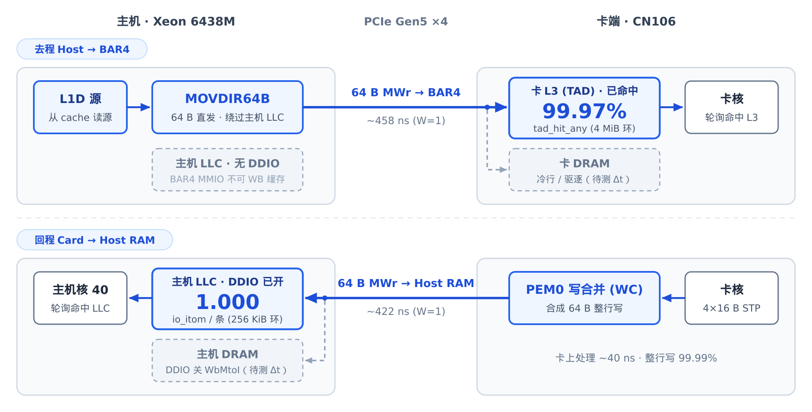

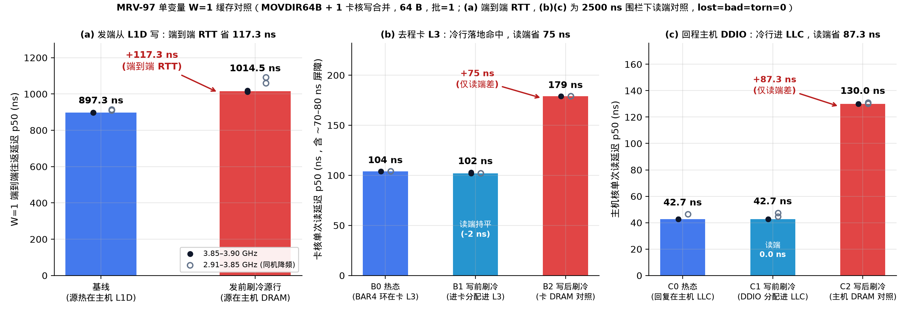

   * 很多人误以为没有 `CXL.cache` 硬件一致性，PCIe 读写就必须穿透到慢速 DRAM。我们在 [MRV-97 W=1三段缓存与897ns](https://linear.app/taooceros/issue/MRV-97) 逐段把缓存刷冷做单变量对照（`n = 5` 轮零错），硬件 PMU 证实**整条通路的三段缓存捷径全部默认生效**：
     * **发端主机 L1D 读源**：`MOVDIR64B` 从热 L1 读源相比 `CLFLUSH` 刷冷到主存（`A_cold_src` `1018.2 ns`）直接省 **`117.3 ns`**（端到端）；
     * **去程直落网卡 `48 MiB` L3**：主机写入经 `BAR4` 直接分配进网卡 L3，卡侧 `TAD` 硬件命中率实测 **`99.94%–99.98%`**；在 `2500 ns` 对齐等待下，卡核直接读 L3（`102–104 ns`）比刷冷读卡 DDR5（`179 ns`）快 **`75.0 ns`**；
     * **回程经 Intel DDIO 直落主机 `60 MiB` LLC**：网卡 `PEM0 WC` 写入以 `1.00 ItoM/消息` 直接进入主机 LLC；在 `2500 ns` 对齐等待下，主机读 DDIO 热行（`42.7 ns`）比刷冷读主机 DDR5（`130.0 ns`）快 **`87.3 ns`**。
   * 最终空载 `64 B W = 1` 核到核往返：`MRV-97` 热态稳态达 **`897.3 ns`**（5 轮中位数 `898.2 ns`），后续同套硬件 [MRV-166 异步等尾公平SDP核账本](https://linear.app/taooceros/issue/MRV-166) 实测 **`885 ns`**，比同卡公平优化 `SDP`（`4.635 µs`）快 **`5.24×`**，也快于 `CC-NIC` 引用的商用 PCIe 网卡（CX6 `2.12 µs`、E810 `3.81 µs`）和 MICRO '25 真实 CXL 1.1 硬件网卡 `CXL-NIC`（Fig. 14 约 `1.3 µs`，CXL 上跑 CC-NIC 设计约 `2.1 µs`，且 CXL-NIC 缺少 IOMMU 保护）。

3. **无逐笔 `SFENCE` 如何保证不读到半包或乱序？（原子 `64 B` + 头尾双序号保序）**：
   * **单格写入（`64 B`）**：x86 `MOVDIR64B` 指令保证单条 `64 B` 直接存储的 64 字节写入原子性，但与相邻地址写入之间是弱保序的（主机侧测试证实不同行可乱序到达）。因此我们绝不依赖“物理顺序”，而是在软件协议层做严格兜底：**每个 `64 B` 格首尾同时携带单调 64 位序号 `seq`**，接收端按环位顺序轮询下一槽（早到的后格静待在自己槽里），只有头尾 `seq` 与载荷校验字全部吻合才消费。
   * **卡侧 WC 回写与多格直推（`≤ 256 B`）**：网卡 `PEM0 WC` 正常凑成一整笔 `64 B` 写；若偶发拆写乱序，或主机多格直推（`mrv127` 先写中间格与尾格、最后写头格，无 `SFENCE`）中分片尚未齐整，接收端逐格核验头尾序号与中间行，未齐即重试等待（如 [MRV-117 DirectPush大小包分工](https://linear.app/taooceros/issue/MRV-117) `256 B W=16` 观测到 `13` 次初见未齐并被安全吸收，最终 `torn = 0`）。
   * **大包 DMA 路径（`≥ 512 B`）**：主机写完普通内存载荷后仅执行 **每消息 1 次 `SFENCE`** 再发 `64 B` `MOVDIR64B` 指令（避免 `MOVDIR64B` 越过普通 store 导致网卡读脏，零 `SFENCE` 压测可出现 `4.2–5.2%` 脏读，加 `SFENCE` 后 `2.68 亿` 笔零脏读）；回程由网卡同一 `DPI ToHost` 队列先发载荷写、最后发 `64 B` 完成格，依托 PCIe 规范对同发起者非 RO 投递写的严格保序，所有大包实测 `late = 0, torn = 0`。
   * **全项目验真记录**：横跨全部 CC-NIC 实验（含超 `25 亿` 双向/端到端消息与以太网帧，若计入单向满载流超 `350 亿` 格），**`torn = 0`、`bad = 0`**，无一例撕裂被消费。

---

## 第 2 章 发送缓冲与零一致性税：无损直推原地复用与 `128 MiB` 留存池

> **本章回答**：去掉硬件缓存一致性之后，在真实协议栈（尤其是 TCP 等需要长期留存已发送数据以备重传的场景）里，我们是吃亏了还是反而占了大便宜？

### 2.1 先拆清发送缓冲的两层生命周期

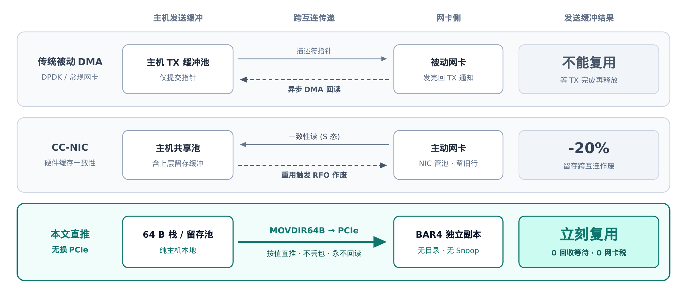

发送网络包时，缓冲生命周期有两层完全不同的需求，传统网卡和 `CC-NIC` 都把它们搅在了一起：

1. **主机 → 网卡这一跳（PCIe 发射生命周期）**：传统 DMA 网卡只拿地址，主机必须一直锁着缓冲等网卡异步读完并通知回收；而 **PCIe 是不会丢包的无损链路**，主机用 `MOVDIR64B` 把 `≤ 256 B` 小包**按值**推进网卡内存后，网卡永远不会回头读主机内存——如果上层不需要重传备份（UDP、无状态 RPC），CPU 推完当场就能原地覆写同一块缓冲。
2. **主机 → 远端网络这一跳（协议栈留存生命周期，如 TCP 重传池）**：以太网会丢包，TCP 收到远端 ACK 前必须自己把发过的包留在主机大池里。对 `CC-NIC` 而言，网卡通过一致性协议读过这些缓冲行、把副本留在了网卡缓存里；等主机以后复用这些缓冲时，每次都要跨互连通知网卡作废——`CC-NIC` 论文 Fig. 15 实测仅禁用 TX 栈式复用（第 1 步）吞吐就掉 **`−20%`**，叠加 `4 KiB` 步长（第 2 步）累计掉 **`−50%`**，叠加去掉 NIC 共享池（第 3 步）累计暴跌 **`−73%`**。而在非一致直推下，主机留存池从未进入网卡一致性域，**跨链路一致性作废税严格为 0**。

### 2.2 核心实测：原地复用 `174.8 M/s`、`128 MiB` 留存仅 `−0.9%` 与 `2112 B` 破组别名

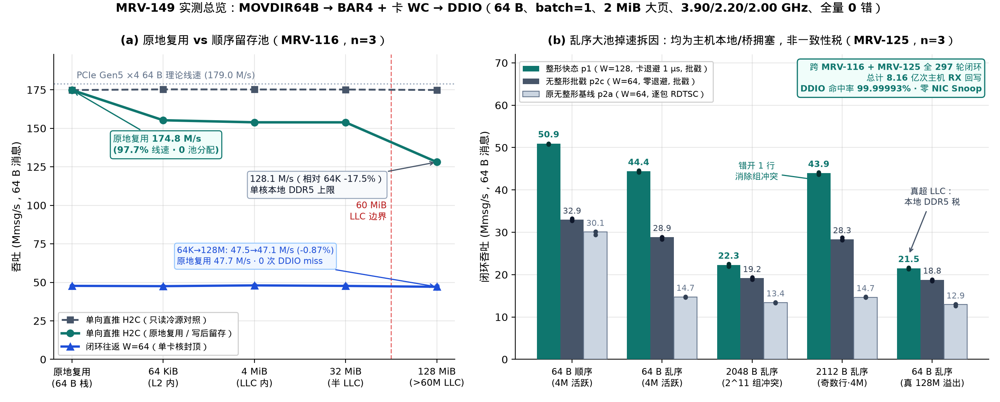

基于 [MRV-116 发送缓冲复用与128M留存](https://linear.app/taooceros/issue/MRV-116)（204 轮零错）与 [MRV-125 2KiB乱序留存与2112B破别名](https://linear.app/taooceros/issue/MRV-125)（165 轮零错，恢复 `MAX_DRAIN = 32` 并整形避开入向桥拥塞），固定 `64 B` 小包、1 主机核 + 1 网卡核、全程 `IOMMU` 与 `2 MiB` 大页：

1. **不留存、原地复用单块 `64 B` 缓冲（`stack_0`）**：单向主机→卡直推达 **`174.84 M/s`**（`n = 3` 均值，中位数 `175.23 M/s`，占 Gen5×4 线速 `97.7%`），完全免去发送缓冲池管理。若边写留存池边推，`32 MiB` 缓存内为 `153.88 M/s`，扩至 `128 MiB` 为 `128.09 M/s`（纯主机单核同时写本地 DDR5 与发 PCIe 的上限）。
2. **双向一问一答下，把顺序留存池放大 `2,048×`（`64 KiB → 128 MiB`，超 `60 MiB` LLC）**：
   * 闭环 `W = 64` 吞吐几乎走成一条水平线：`stack_0` `47.71 M/s` → `64 KiB` `47.52 M/s` → `128 MiB` **`47.10 M/s`**（`64 KiB → 128 MiB` 仅 **`−0.87%` / 约 `−0.9%`**），`W = 1` 延迟始终稳在 `0.91 µs`。
   * **跨 `8.16 亿` 次网卡回写零一致性污染**：合并 [MRV-116 发送缓冲复用与128M留存](https://linear.app/taooceros/issue/MRV-116)（`282,686,355` 命中 / `102` 缺失，`99.999964%`）与 [MRV-125 2KiB乱序留存与2112B破别名](https://linear.app/taooceros/issue/MRV-125)（`533,200,135` 命中 / `458` 缺失，`99.999914%`），网卡回写主机 LLC 的 DDIO 总命中率高达 **`99.999931%`**，其中 `128 MiB` 留存下 **`0` 次未命中**。
3. **2 KiB 乱序 `mbuf` 池掉速的精确拆因：100% 是主机本地缓存组别名与 DDR5 上限，与网卡无关（[MRV-125 2KiB乱序留存与2112B破别名](https://linear.app/taooceros/issue/MRV-125)）**：

| 留存池形态（固定 `65,536` 个活跃槽位，避开入向桥拥塞，`n = 3` 中位数） | 闭环吞吐（`M/s`） | 网卡回写 DDIO 命中 | 物理归因 |
| :--- | ---: | ---: | :--- |
| 紧凑顺序 `4 MiB`（`64 B` 步长） | **`50.92`** | `100%` | 全驻主机 LLC |
| 紧凑乱序 `4 MiB`（`64 B` 步长随机） | **`44.37`** | `100%` | 全驻 LLC，仅多随机访问开销 |
| 标准 `2048 B` 步长乱序 `128 MiB` 池（活跃数据仅 `4 MiB`） | `22.28`（腰斩） | `100%` | `2048 = 2¹¹` 触发 CPU LLC 严重**缓存组别名**，全部挤进 `1/32` 缓存组 |
| **一招证伪：仅把步长 `+64 B` 改为 `2112 B` 乱序（`132 MiB` 池）** | **`43.93`** | `100%` | **立刻弹回接近满速**，证明 `2048 B` 掉速并非网卡问题（也反推 `CC-NIC` Fig. 15 切 `4 KiB` 步长的 `−37%` 跌幅混入了显著主机组别名） |
| 真正 `128 MiB` 全随机活跃访问（`64 B` 步长，真超 `60 MiB` LLC） | `21.48` | `100%` | 主机本地随机访问 DDR5 的真实物理上限，网卡侧 DDIO 仍零缺失 |

> **范围边界**：本章解决的是「小包发送缓冲即时复用」与「主机自留存池免交一致性税」；当网卡面对突发收包流、需要作为 **active entity** 主动接管接收缓冲时，我们将在第 6 章（[MRV-153 主动网卡缓冲管理设计](https://linear.app/taooceros/issue/MRV-153) / [MRV-158 主动网卡突发缓冲实测](https://linear.app/taooceros/issue/MRV-158)）完整展开实测。

---

## 第 3 章 高并发拥塞与流控：单写单读踩写前沿冲撞与主机信用限流

> **本章回答**：`CC-NIC` 用双路 Xeon 仿网卡，看不到真实 PCIe 网卡硬件桥的微架构陷阱。我们在真 CN106 上高并发直推时撞出了什么物理拥塞？怎么用主机信用限流稳住尾延迟，纯主机侧的硬边界在哪里，下一步读/写协同流控该如何演进？

### 3.1 先澄清最常见误会：`~13.1 M/s` 不是通路带宽上限，而是特定「单写单读前沿冲撞」陷阱

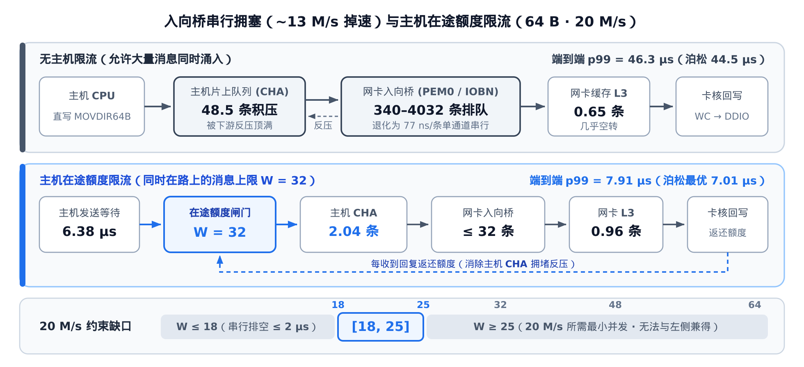

* 前文第 1 章已证实，主机单核直写 BAR4 的物理吞吐上限是 **`175.2 M/s`**（边推边全验真 `161.6–162.6 M/s`，单核一问一答稳态 `50.9 M/s`）。
* 但在高并发（`W = 48–128`）且卡核紧盯队头空轮询的条件下，吞吐会突然跌落至 **`13.09 M/s`**（每条约 **`76.39 ns`**），开环 `p99` 飙升至 `44–51 µs`。通过四组双端 `100%` 非复用 PMU 排查，我们把物理因果彻底钉死：
  1. **前沿写带嗅探（[MRV-76 前沿写带嗅探定位](https://linear.app/taooceros/issue/MRV-76)、[MRV-55 卡L3 64B一致性粒度](https://linear.app/taooceros/issue/MRV-55)）**：在连续单向推流中，只要卡核读已落地的旧格（`next − 1`），去程仍保持 `159.8 M/s`；一旦卡核越前去读尚未落地的在途写带（约前方 `3 µs`），吞吐跌至 `113.5 M/s`；只要避开前方 `~3 µs` 写带，哪怕读穿透卡 L3 的冷行也能恢复 `160.4–162.6 M/s`。同时 [MRV-55 卡L3 64B一致性粒度](https://linear.app/taooceros/issue/MRV-55) 证实卡 L3 一致性粒度严格为 `64 B`。
  2. **锁定堵点在 `PEM0 / IOBN` 入向桥单通道串行（[MRV-75 入向桥串行定位](https://linear.app/taooceros/issue/MRV-75)、[MRV-112 环格步长排查入向桥](https://linear.app/taooceros/issue/MRV-112)）**：拥塞爆发时，主机 32×CHA 被反压倒灌，而网卡后端 L3 网格 `TAD` 占用反而空到仅 `0.02–0.12` 条——`42–113` 条在途请求全堵在 `PEM0 / IOBN` 入向桥内，退化成 **`76.39 ns/条`（`13.09 M/s`）** 单列放行。在 [MRV-112 环格步长排查入向桥](https://linear.app/taooceros/issue/MRV-112)（86 轮）里把请求环步长从 `64 B` 一路拉开到 `128 B / 4096 B / 4224 B`，4 卡核下依然全部锁死在 **`13.12–13.55 M/s`**，彻底排除了伪共享与同页预取，坐实物理根因是：**卡核以 `70–98 M/s` 显式空轮询把未落盘的队头 `next` 格拽进私有缓存，主机对该格的 Posted Write 抵达 `PEM0 / IOBN` 时必须先向 `TAD` 发嗅探失效握手并等待确认，整座入向桥被迫降格为单列保序事务**。

### 3.2 主机在途信用限流的实测收益与 `[18, 25]` 算术边界

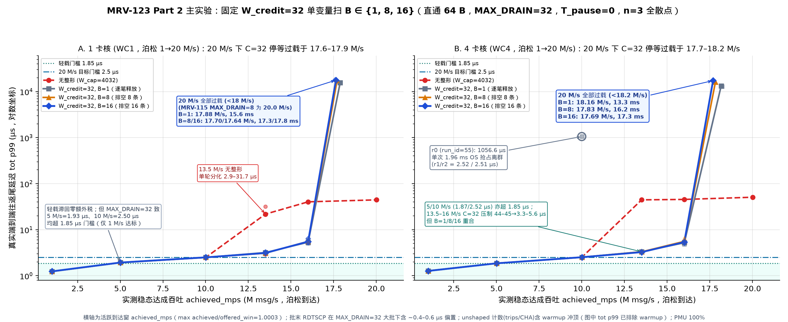

在不改动卡核紧盯策略（以保住轻载 `~0.9 µs` 延迟）的前提下，我们在 [MRV-115 主机在途信用整形](https://linear.app/taooceros/issue/MRV-115)（459 轮）与 [MRV-123 恢复MAX_DRAIN与信用边界](https://linear.app/taooceros/issue/MRV-123)（255 轮，恢复 `MAX_DRAIN = 32` 消除批收包干扰）上测试主机在途信用上限 `W_credit` 与批释放滞回 `B`：

* **显著压低尾延迟并清零主机 CHA 倒灌**：无流控时主机 CHA 队列倒灌到 `48.5–248.4` 条，`20 M/s` 泊松到达 `tot p99` 达 **`44.46 µs`**（4 卡核 `50.72 µs`）。加上主机在途信用上限后，多余排队被拦在主机软件本地，CHA 倒灌降至 **`1.4–3.1` 条**，`16–30 M/s` 真实端到端 `tot p99` 压降 **`6–64×`**——例如 `20 M/s` 泊松在 `W_credit = 48, release_batch = 32` 下从 `44.46 µs` 压至 **`7.01 µs`**（纯线端 `wire p99 = 3.23 µs`），4 卡核高并发稳态吞吐回升 `+43%`。
* **诚实探明纯主机限流的 `[18, 25]` 硬算术边界**：只要卡核仍无停顿狂查队头，在途一多就会偶发触发 `~77 ns/条` 排空，整批排空时间严格服从 `0.58 µs + W_credit × 77 ns`：
  * 要把排空压进 `≤ 2 µs`，在途额度必须 `W_credit ≤ 18`；
  * 但要在 `~1.25 µs` 往返下撑住 `20 M/s` 吞吐，利特尔定律要求在途至少 `20 × 1.25 = 25` 条。
  * `[18, 25]` 是纯主机软件无法跨越的算术缺口（实测 `W_credit = 32` 吞吐就封顶在 `17.88 M/s` 导致排队发散，`W_credit = 48` 虽撑住 `20 M/s` 但最优 `tot p99 = 7.01 µs`；纯主机稳守 `≤ 2 µs` 的安全区为单卡核 `≤ 13.5 M/s`、4 卡核 `≤ 10 M/s`）。

### 3.3 真实双机 `100GbE` 四核 RSS 复现与单主机核 `48.2 M 行/s`

在接上真实 `100GbE` 物理网线并扩至 `4` 核 `eth0` RSS（每包 `256 B = 4` 条 `64 B` 缓存行）后：
* **[MRV-135 双机4核RSS行信用破拥塞](https://linear.app/taooceros/issue/MRV-135)（198 轮）**：不限流时微突发一头撞在 **`13.31–13.33 M 行/s`** 串行拥塞上（CHA 积压 `38.6` 条）；开启卡侧消费游标反馈的在途行信用 `C_line = 48` 后，CHA 降回 `2.1` 条，稳态容量一口气推升至 **`22.53 M 行/s`**（`+69%`）；但共享紧凑环上把 `C_line` 放宽到 `64` 又会重撞回 `14.26 M 行/s`。
* **[MRV-137 独占子环与多主机核扩展](https://linear.app/taooceros/issue/MRV-137)（213 轮）**：把 4 颗卡核拆成**每核独占 `128 B` 步长 BAR4 子环**并去掉冗余内存池访存后，出现了反直觉发现——**仅仅 1 颗主机核就跑出了 `33.24 M 行/s`**，与 2 核（`33.33`）、4 核（`33.53 M 行/s`）几乎重合；拿掉信用上限在 `W = 256` 下 1 核和 4 核更是共同冲上 **`48.15–48.20 M 行/s`**（达纯 4 核 `card_echo` 极限 `57.49 M 行/s` 的 `83.8%`）。追查源码确认，`33.5 M 行/s` 上限不是主机核瓶颈，而是卡侧原型把信用回写放在了收包循环**外部**造成每 `1.91 µs` 整窗锁步停等（也白烧了 4 核 `71%` 的信用自旋时间，改入循环内滑窗流水见 Backlog [MRV-147 滑窗流水消除整窗锁步](https://linear.app/taooceros/issue/MRV-147)）。

### 3.4 机理升华与下一步控制展望（[MRV-173 读写冲撞与在线控窗分析](https://linear.app/taooceros/issue/MRV-173)）

在 [MRV-173 读写冲撞与在线控窗分析](https://linear.app/taooceros/issue/MRV-173) 的深度讨论中，我们明确拒绝了泛化的「多核 Spinlock 争锁 / 一致性风暴」包装（我们的环是单写单读、且并发 `W = 256` 反而逃出 `13.1 M/s` 冲上 `48.2 M 行/s`，并非单调退化；Flat Combining / MCS / Ticket 在主机无锁争用下反而加延迟或造跨队列 HoL），而是提炼出精准的**「读端护服务率 + 写端在线控窗」正交分工**：
1. **读端（打破 `[18, 25]` 缺口）**：借鉴 **FastForward（PPoPP '08）的 Temporal Slipping** 思想——不是盲目按固定时间 `1.8 µs` 休眠（会拖慢轻载 `0.9 µs` 且让核空睡 `79%`），而是按「读端落后写端格数 / 忙批门控（[MRV-143 卡侧忙批门控自适应退避](https://linear.app/taooceros/issue/MRV-143)）」仅在突发成批到达时让读端轻微退避，把吞吐沿「每交接摊几格」曲线拉离 `76.4 ns` 串行坑，同时保住轻载 `~0.9 µs`。
2. **写端（消除静态 `C_line` 硬编码质疑）**：引入 **BBR-over-PCIe 在线信用控窗**——因为并发 `4 KiB` `DPI DMA` 抢占桥缓冲会让安全窗口在 `80 ↔ 32` 行动态漂移（见第 4 章 [MRV-127 双信用窗HoL隔离与随机KV](https://linear.app/taooceros/issue/MRV-127)），主机可凭实时信用回程斜率 `Δwire_RTT / Δinflight`（逼近 `~76 ns/行` 即乘性缩窗、平坦则加性探增）自动追踪最优 `C_line`。

---

## 第 4 章 完整接口 DirectPush 与挤干水分的公平省核账本

> **本章回答**：真实应用同时有小消息（`≤ 256 B`）和 `1–4 KiB` 大载荷，只用商用网卡自带原生 `DPI DMA`（零 Intel DSA）拼出完整接口 `DirectPush` 后，大包省多少核、混流怎么防队头阻塞？最重要的是——**把传统 `SDP` 改造成非阻塞异步等尾并公平对齐全部配置、彻底挤干水分后，`DirectPush` 到底还省多少主机核，哪些是真硬件优势、哪些是 DPDK 软件栈税？**

### 4.1 大小包双通道分工与 `14,701×` HoL 隔离（[MRV-117 DirectPush大小包分工](https://linear.app/taooceros/issue/MRV-117)、[MRV-127 双信用窗HoL隔离与随机KV](https://linear.app/taooceros/issue/MRV-127)）

早期曾在 [MRV-95 卡直驱DSA归档](https://linear.app/taooceros/issue/MRV-95) 探索过卡直驱主机 Intel DSA，但在 [MRV-120 论文大纲与零DSA定案](https://linear.app/taooceros/issue/MRV-120) 拍板**彻底剔除 Intel DSA**，仅靠商用网卡人手必备的原生 `DPI DMA`（单向实测达 `97%` 线速，[MRV-22 开环极限与原生DPI](https://linear.app/taooceros/issue/MRV-22)）拼出纯商用网卡接口 `DirectPush`：
* **小包（`≤ 256 B`）**：走无一致性 `MOVDIR64B + PEM0 WC` 缓存直推，保住 `0.885 µs` 亚微秒延迟与原地复用；
* **大包（`≥ 512 B`）**：主机仅推 1 条 `64 B` 指令（含数据地址），由网卡原生 `DPI DMA` 直接零拷贝拉取/回写主机 `128 MiB` 留存池。

核心实测验证（1 主机核 + 1 网卡核，零 DSA，全程 IOMMU）：
1. **大包切原生 `DPI DMA` 较全尺寸直推省 `2.86×` 核（[MRV-117 DirectPush大小包分工](https://linear.app/taooceros/issue/MRV-117)，333 轮）**：`4 KiB @ 1.0 M/s`（`8.19 GB/s` 双向）同核混跑业务时，全尺寸直推把主机核吃掉 **`46.63%`**，切到 `DirectPush` 原生 `DPI DMA` 后主机核占用骤降至 **`16.32%`**（省 **`2.86×`**），主机 LLC 读缺失归零（`0.00 次/包`）；在以大包为主的 `Mix-Geo` 混合负载下，全尺寸直推被拖垮至 `7.76 GB/s`（小包 `p99 = 19.5 µs`），而 `DirectPush` 跑满 `18.68 GB/s` 且小包 `p99` 稳在 `1.50 µs`。
2. **双信用窗实现 `14,701×` 开环大包 HoL 隔离（[MRV-127 双信用窗HoL隔离与随机KV](https://linear.app/taooceros/issue/MRV-127)，228 轮）**：将小包与大包拆分独立发送信用窗 `(W_small=32, W_large=32)` 并加 BAR4 行限 `32` 后，`512 B` 切入 DMA 提速 `3.47×`；在开环泊松混流中，即使 `4 KiB` 大包将 `18.6 GB/s` 带宽彻底打满饱和，共享额度窗下 `64 B` 小包被堵至 **`40.50 ms`**（`40,500 µs`），而拆分双窗将 `64 B` 小包 `tot p99` 死死守在 **`2.755 µs`**（压降 **`14,701×`**，全额 `8.00 Mreq/s` 交付）。在 `128 MiB` 留存池 `98.4%` 随机跨页 KV 访存下，`4 KiB` DMA 退化为 `0.0%`（需注明 `128 MiB = 64` 张 `2 MiB` 大页尚在硬件 IOTLB 内；多 GiB 与 `4 KiB` 普通页扩展见 Backlog [MRV-139 多GiB随机KV与IOTLB扫描](https://linear.app/taooceros/issue/MRV-139)）。

### 4.2 挤干水分：[MRV-166 异步等尾公平SDP核账本](https://linear.app/taooceros/issue/MRV-166) 公平异步等尾 `SDP` 复测与四层省核账本

早期实验（[MRV-117 DirectPush大小包分工](https://linear.app/taooceros/issue/MRV-117)、[MRV-133 真实双机100GbE基线对比](https://linear.app/taooceros/issue/MRV-133)）中的强对照 `SDP` 虽然开启了内存轮询（`rx_poll_mem=1`）和零拷贝，但每当 `4 KiB` 包头先到、包尾尚在 PCIe 路上时，主机都会原地自旋死等（`late_tails` 高达 `54.8%–93.8%`），同时 `2048` 槽 RX 环溢出 DDIO。为了回答「如果把 `SDP` 做到尽可能公平，到底还剩多少真省核？」，我们在 [MRV-166 异步等尾公平SDP核账本](https://linear.app/taooceros/issue/MRV-166)（126 轮全零错，经 [MRV-167 MRV-166评审](https://linear.app/taooceros/issue/MRV-167) 评审定案）为 `octeon_ep` 驱动加入纯 opt-in 旋钮，逐档单变量挤干水分：

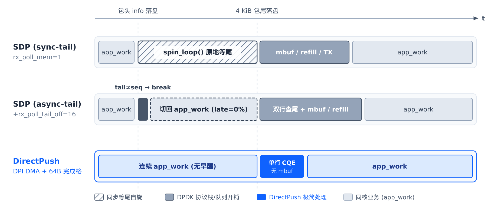

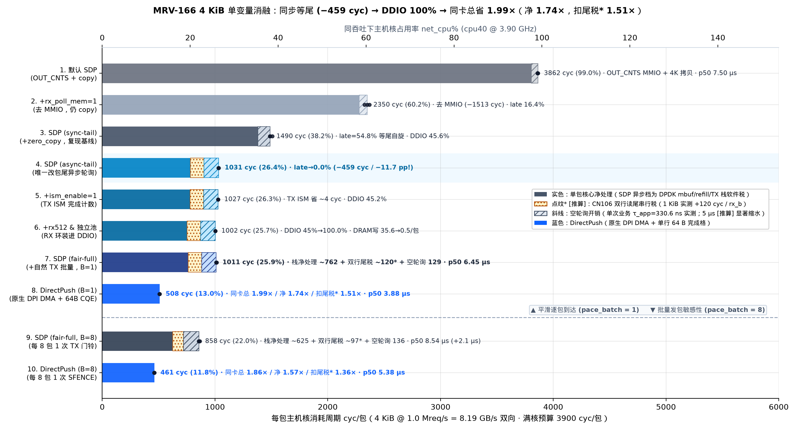

#### 1. `4 KiB @ 1.0 M/s` 单变量逐档消融（同核业务量子 `τ_app = 330.6 ns`，`n = 3` 中位数）

| 逐档单变量配置 | `net_cpu%` | 总核耗 `cyc/包` | `late_tails` | `DDIO` 命中 | `p50` (`µs`) | 这一步剥离了什么？ |
| :--- | ---: | ---: | ---: | ---: | ---: | :--- |
| 1. 默认 `SDP`（`OUT_CNTS` + copy） | `99.00%` | `3860` | `0.00%` | `98.0%` | `7.50` | 跨 PCIe 读寄存器 + CPU 拷贝 |
| 2. `+rx_poll_mem=1`（去 MMIO，仍 copy） | `60.19%` | `2348` | `16.41%` | `98.9%` | `6.64` | 砍掉 `OUT_CNTS` 跨总线空轮询 |
| 3. `SDP (sync-tail)`（`+zero_copy`，旧强对照） | `38.17%` | `1490` | **`54.78%`** | `45.6%` | `6.12` | 砍掉 CPU 拷贝，但暴露同步等尾水分 |
| 4. **`+rx_poll_tail_off=16`（唯一改异步包尾）** | **`26.40%`** | **`1031`** | **`0.00%`** | `45.5%` | `6.29` | **清零等尾自旋，实砍 `−459 cyc/包`** |
| 5. `+ism_enable=1`（TX ISM 完成计数） | `26.30%` | `1027` | `0.00%` | `45.2%` | `6.29` | 微省每 256 包一次 `IN_CNTS` 读 |
| 6. `+rx512 & 独立池`（RX 环缩进 DDIO） | `25.67%` | `1002` | `0.00%` | **`100.0%`** | `6.45` | 主机 DRAM 写暴跌 `71×`（`35.6 → 0.5 CAS/包`） |
| 7. **`SDP (fair-full, B=1)`（完整公平基线）** | **`25.90%`** | **`1011`** | **`0.00%`** | **`100.0%`** | `6.45` | 公平对齐后的同卡最优 `SDP` |
| 8. **`DirectPush (B=1)`** | **`13.03%`** | **`508`** | **`0.00%`** | **`100.0%`** | **`3.88`** | 相对公平 `SDP` 总倍率 **`1.99×`** |
| 9 / 10. 批发 `B=8`：`SDP fair` vs `DirectPush` | `21.97%` vs `11.83%` | `858` vs **`461`** | `0.00%` | `100.0%` | `8.54` vs **`5.38`** | 8 包 1 门铃 / 1 `SFENCE` 后仍差 **`1.86×`** |

#### 2. 全粒度三档四层无水分省核账本与诚实归因分水岭

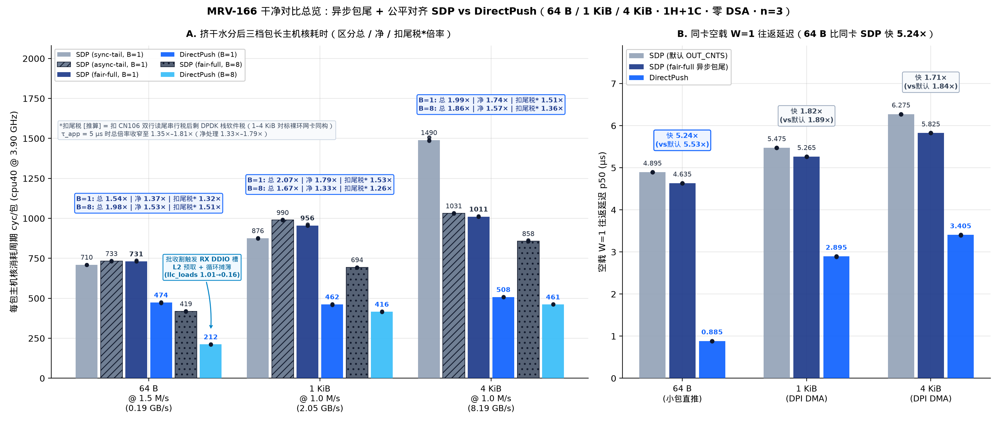

| 包长与速率 | 批量 | `SDP fair-full` (`cyc/包` / 占核) | `DirectPush` (`cyc/包` / 占核) | ① 同卡总倍率 (`τ_app=330.6ns`) | ② `[推算]` `τ_app=5µs` | ③ 扣空轮询净处理倍率 | ④ `[推算]` 扣双行尾税 DPDK 栈税 | 同卡 `W=1` `p50` (`SDP fair` vs `DP`) |
| :--- | :-: | ---: | ---: | :-: | :-: | :-: | :-: | :-: |
| **`64 B` @ `1.5 M/s`** | `B=1` | `731` / `28.10%` | **`474`** / **`18.21%`** | **`1.54×`** | `1.38×` | `1.37×` | `1.32×` (`+150 cyc`) | `4.635` vs **`0.885 µs`（快 `5.24×`）** |
| **`64 B` @ `1.5 M/s`** | `B=8` | `419` / `16.10%` | **`212`** / **`8.15%`** | **`1.98×`** | `1.56×` | `1.53×` | `1.51×` (`+107 cyc`) | — |
| **`1 KiB` @ `1.0 M/s`** | `B=1` | `956` / `24.50%` | **`462`** / **`11.84%`** | **`2.07×`** | `1.81×` | `1.79×` | `1.53×` (`+244 cyc`) | `5.265` vs **`2.895 µs`**（快 `1.82×`） |
| **`1 KiB` @ `1.0 M/s`** | `B=8` | `693` / `17.76%` | **`416`** / **`10.67%`** | **`1.67×`** | `1.35×` | `1.33×` | `1.26×` (`+107 cyc`) | — |
| **`4 KiB` @ `1.0 M/s`** | `B=1` | `1011` / `25.90%` | **`508`** / **`13.03%`** | **`1.99×`** | `1.76×` | `1.74×` | `1.51×` (`+256 cyc`) | `5.825` vs **`3.405 µs`**（快 `1.71×`） |
| **`4 KiB` @ `1.0 M/s`** | `B=8` | `857` / `21.97%` | **`462`** / **`11.83%`** | **`1.86×`** | `1.59×` | `1.57×` | `1.36×` (`+165 cyc`) | — |

把挤干同步等尾后的剩余差距拆清四层，得出论文必须严守的**诚实归因分水岭**：
1. **短业务量子放大空轮询底噪**（`+83 ~ +142 cyc/包`）：`SDP` 经 DPDK `ethdev` 间接调用空轮询一次耗 `57.7 cyc`（零载占核 `4.27%`），`DirectPush` 内联原子读仅 `≈ 0.7 cyc`（`0.04%`）。当业务量子拉长到典型微服务 `5 µs` 时，总倍率自动收窄至 `[推算] 1.35–1.81×`（贴近净处理倍率 `1.33–1.79×`）。
2. **CN106 软件双行查尾串行税**（`B=1` 约 `+24 / +120 cyc/包`）：`rx_poll_tail_off=16` 必须先读 `info->length` 再串行加载第二条包尾缓存行（且该机制依赖 64 位单调唯一 `seq`，仅限受控基准，不可作通用驱动特性），而真实硬件 CQE 只需读 1 条独立完成格。
3. **通用 DPDK 软件栈税（`[推算] 1.26–1.53×`，`+107 ~ +256 cyc/包`）**：PMU 实测 `SDP` 净单包多退休 `+317 ~ +629` 条指令（`mbuf` 分配/释放、`flush_iq`、`rx_refill` 补槽门铃）。
4. **对标现代商用网卡（`mlx5` / `E810` / `CN20K`）的诚实定位**：
   * **`1–4 KiB` 大包**：`DirectPush` 与现代裸静态环网卡（如 `mlx5` DevX 静态 UMEM + `BlueFlame` 64 B 推 WQE + 硬件 CQE）在 PCIe 事务与主机动作上**完全同构**，剩余 `1.26–1.53×` 属于**软件栈开销差，不宣称为相对裸环现代网卡的硬件省核优势**。
   * **`64 B` 小包**：免去 TX DMA 二次读主机内存（`iio1_inb_rd: 0.0` vs `2.2 次/包`）、本地发送缓冲推完即复用、以及同卡 `W = 1` **`5.24×`** 延迟硬优势，属于**真实接口/硬件优势**（`64 B B=8` 降至 `212 cyc/包` 亦含 8 包成批返回触发 `+256 B` RX 完成槽 L2 步长预取效应）。

---

## 第 5 章 真实双机 `100GbE` 端到端全量验证（延迟 + 双向 + 单向 TX + 单向 RX）

> **本章回答**：把 `DirectPush` 接上真实 `NIX0 / RPM0` 以太网硬件和 `3 m` `100GbE` 物理直连线对接 `mercury`（ConnectX-5）后，延迟、双向吞吐、以及**严格 1 颗主机核**的单向发包（TX）和单向收包（RX）究竟表现如何？

### 5.1 端到端延迟与缓存 CQE 窥探：真实双机主机⇄卡增量重回 **`0.935 µs`（`< 1 µs`）**

1. **真实双机 `100GbE` 同轮基线对比（[MRV-118 片上NIX0硬件回环](https://linear.app/taooceros/issue/MRV-118) 片上 NIX 回环 + [MRV-133 真实双机100GbE基线对比](https://linear.app/taooceros/issue/MRV-133) 348 轮真双机）**：

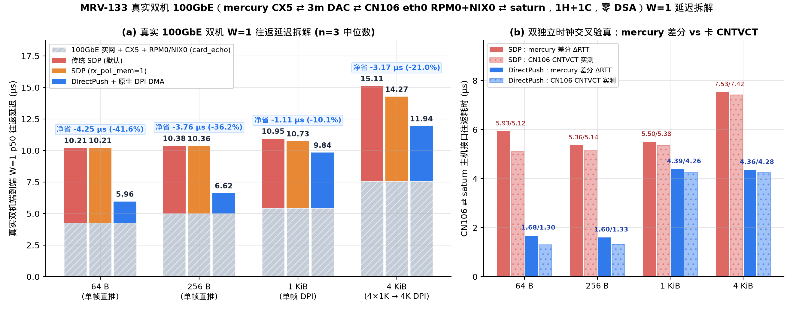

   * 插网线前的片上 `NIX0 + LBK0` 硬件回环（[MRV-118 片上NIX0硬件回环](https://linear.app/taooceros/issue/MRV-118)）中，`64 B` 净省 `3.88 µs`（`−47.5%`）。
   * 插上 `3 m` `100GbE` 物理网线连 `mercury`（[MRV-133 真实双机100GbE基线对比](https://linear.app/taooceros/issue/MRV-133) 同轮 `W = 1` 对比，`n = 3` 中位数）：
     * `64 B`：`SDP` **`10.205 µs`** → `DirectPush` **`5.955 µs`**（净省 **`4.25 µs` / `−41.6%`**；扣除无主机 `card_echo` 底噪 `4.275 µs`，主机接口增量从 `5.93 µs` 砍到 `1.68 µs`，卡内独立硬件时钟 `CNTVCT_EL0` 实测 `1.31 µs`）；
     * `256 B / 1 KiB / 4 KiB`：`SDP` `10.375 / 10.945 / 15.105 µs` → `DirectPush` **`6.615 / 9.835 / 11.935 µs`**（`card_echo` 底噪 `5.015 / 5.445 / 7.575 µs`）；
     * 开环 `64 B` 泊松 `2.0 M/s` 负载：`tot p99` 从 `SDP` 的 `26.25 µs` 砍半至 **`12.615 µs`**。

2. **根治双机多出的 `+0.41 µs`：缓存 CQE 窥探将空轮询压降 `118×`（[MRV-154 双机+0.41µs与LDADDA定位](https://linear.app/taooceros/issue/MRV-154) 78 轮 + [MRV-161 缓存CQE窥探恢复亚微秒](https://linear.app/taooceros/issue/MRV-161) 156 轮）**：

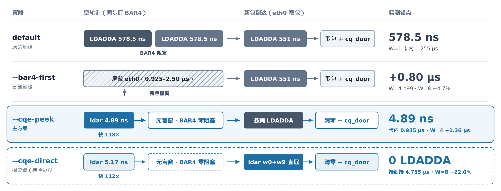

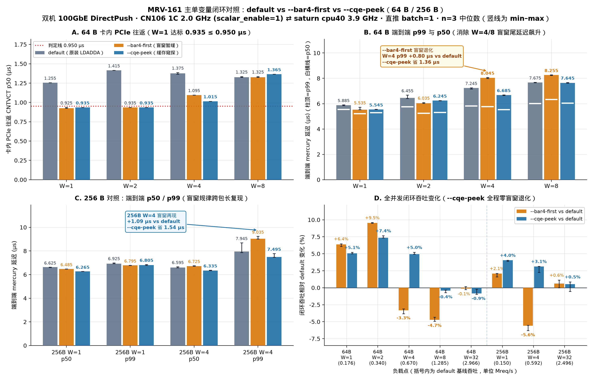

   * **定位硬件元凶（[MRV-154 双机+0.41µs与LDADDA定位](https://linear.app/taooceros/issue/MRV-154)）**：为什么单机裸环只要 `0.89 µs`，双机卡内却要 `1.305 µs`？单变量消融排除了 `NPA mbuf` 释放（仅 `10 ns`）和低频冷态（`0–6 µs` 恒为 `0.915–0.925 µs`），最终抓出真凶——`cnxk` DPDK PMD 每次空轮询 `eth0` 都会发一条同步片内 MMIO 原子指令 `LDADDA NIX_LF_CQ_OP_STATUS`，一次死卡 **`581.84 ns`**（[MRV-161 缓存CQE窥探恢复亚微秒](https://linear.app/taooceros/issue/MRV-161) 标量探针 **`578.51 ns`**），比本地 L1 `BAR4 ldar`（`0.52–0.66 ns`）慢千倍，把 `W = 1` 固定量化锁死在 `2 × 582 ns` 阶梯（`1.305 µs`）。
   * **标本兼治（[MRV-161 缓存CQE窥探恢复亚微秒](https://linear.app/taooceros/issue/MRV-161)）**：`MRV-154` 的权宜方案 `--bar4-first`（等 `BAR4` 时暂缓轮询 `eth0` 至多 `2.5 µs`）虽把 `W = 1` 压回 `0.935 µs`，但一到 `W = 4 / 8` 或 `0.5 Mreq/s` 泊松就会撞盲窗引发队头阻塞（`p99` 恶化 `+0.58 ~ +1.09 µs`、吞吐跌 `−3.3% ~ −5.6%`）。`MRV-161` 利用 CN106 `NIX0` 默认开启的 **`cq_ctx->caching = 1`**（硬件把新 `128 B` CQE 直写片内一致性缓存），消费后在写 `cq_door` 前清零首字 + `dmb oshst`，空轮询时只用本地 `ldar` 窥探 `cqe_type != 0`（`--cqe-peek`），有包再按需发 `LDADDA`：
     * 空轮询耗时从 **`578.51 ns` 骤降至 `4.89 ns`（快 `118×`）**；
     * **`64 B W = 1`**：双机主机⇄卡增量 `CNTVCT p50` 从 `1.255 µs` 压回 **`0.935 µs`（`< 1 µs`）**，真实双机 `100GbE` 端到端从 `5.545 µs` 降至 **`5.285 µs`**（`256 B` 从 `6.625 µs` 降至 **`6.265 µs`**）；
     * **`W = 4 / 8` 与开环泊松零盲窗退化**：`64 B W = 4` `p99` 从 `--bar4-first` 的 `8.045 µs` 压回 **`6.685 µs`**（吞吐反升 `+5.0%` 较基线 / `+8.5%` 较盲窗），`0.5 Mreq/s` 泊松全分位 `3/3` 最优，`1.5 Mreq/s` `p99` 较默认基线降 **`1.97 µs`**（`12.215 → 10.245 µs`）；
     * **独立探索臂 `--cqe-direct`（零 `LDADDA`）**：连有包命中后的 `550.8 ns` 按需 `LDADDA` 也一并省掉，将 `64 B W = 1` 端到端再砍 `−530 ns` 至 **`4.755 µs`**、`W = 8` 吞吐再涨 `+22.0%`（`1.567 Mreq/s`）。因存在多段可见序、零段错包死锁、`CQ_ERR` 失明与脏槽重放四项生产边界，保持为探索拆解臂并单开 Backlog [MRV-170 零LDADDA直取生产边界](https://linear.app/taooceros/issue/MRV-170)。

---

### 5.2 双向闭环与严格 1 颗主机核单向发包（TX）：[MRV-155 1核100GbE单向TX与双向](https://linear.app/taooceros/issue/MRV-155) + [MRV-163 独立SMQ消回落与100M顶](https://linear.app/taooceros/issue/MRV-163)

1. **Phase 1 双向闭环（`1H ⇄ 4C ⇄ mercury`，72/72 零错）**：在 4 核 `sdp1-1` RSS 与 4-VF 双向 `DPI` 上，`DirectPush` 于 `4 KiB / 8 KiB` 仅耗 `46.0% / 37.6%` 单主机核即跑出 **`123.7–128.3 / 137.46 Gbps`** 双向载荷（单侧 `74.77 Gbps` 线速，受双向 DPI 引擎上限而非网线限制，而 4 核 `SDP` 止步 `106.5 Gbps` 且主机核耗 `72%–100%`）。
2. **Phase 2 严格 1 颗主机核单向发包 TX（`saturn` 1 核 → CN106 多核 → `100GbE` → `mercury` 多核，178 轮）与 [MRV-163 独立SMQ消回落与100M顶](https://linear.app/taooceros/issue/MRV-163)（48 轮）**：

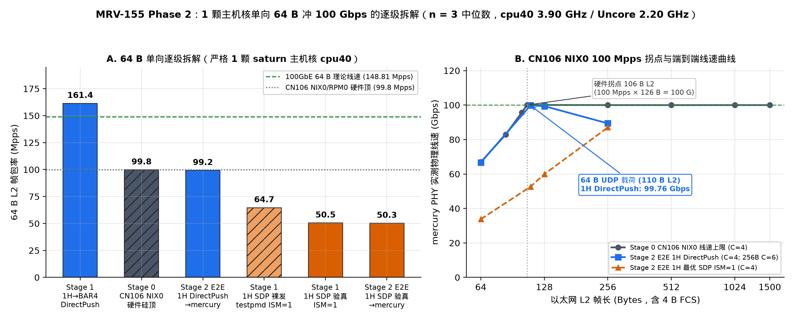

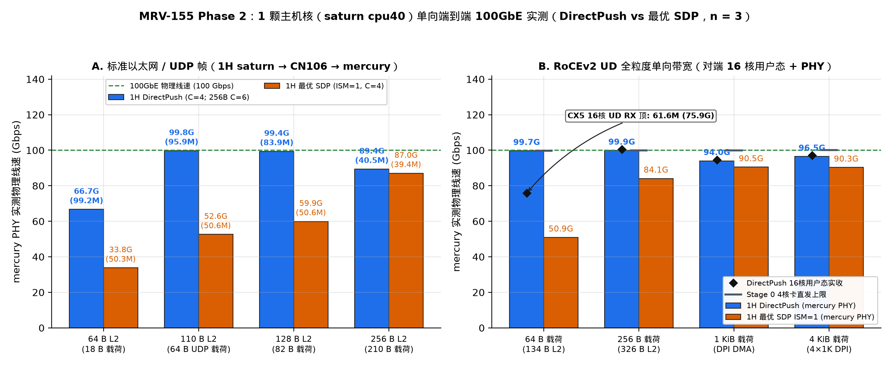

![MRV-163 CN106 eth0 单 SMQ[0] vs 每队列独立 SMQ（RLIMIT）核数扩展实测](figures/mrv-163-smq-scaling.png)

   * **Stage 1（1 核主机进卡，不发网口）**：`DirectPush` 借 `128` 格批门铃 + 1 次 `SFENCE` 让卡核不盯写热行（`tad_rsp_msh_out_retry_exlmn = 0.00 M/s`），单核 `64 B` 单格稳推 **`161.42–161.43 Mpps`**（最优 `SDP ISM=1` 仅 `50.52–50.65 Mpps`，受主机单核 `66.9% sb_stall` 卡死）；`1 KiB / 4 KiB`（4-VF `DPI FromHost` 读）达 **`86.50–86.57 / 88.76–89.14 Gbps`** 载荷。
   * **Stage 0 与 [MRV-163 独立SMQ消回落与100M顶](https://linear.app/taooceros/issue/MRV-163) 定案 `100.0 Mpps` 发包上限**：默认调度树（`ROC_NIX_TM_DEFAULT`，全队列挤单 `SMQ[0]`）在 `C = 4` 跑 `99.63–99.77 Mpps`，但扩到 `C = 6, 8` 核反因 `rvu_nix.c` 关闭 SQM sticky 频繁换队掉至 `84.55 / 82.07 Mpps`（`-15.1% / -17.6%`）。[MRV-163 独立SMQ消回落与100M顶](https://linear.app/taooceros/issue/MRV-163) 单变量切到每队列独立 `SMQ`（`ROC_NIX_TM_RLIMIT`）后，`C = 6, 8` 彻底消除掉速拉回 **`99.67 / 99.63 Mpps`**（`+17.9% / +21.4%`），并定案 CN106 `eth0` 单口 TX 硬顶为 **`100.0 Mpps`**（`C = 4` `99.98 / 100.02 Mpps`，实读 `sclk = 1000 MHz` 精确对应 `10.00 sclk/包`，满 `100GbE` 线速精确拐点为 **`106 B` L2**）。
   * **Stage 2 完整 1 核单向 TX 端到端（对端 `mercury` 无偏 PHY 口径，`n = 3` 中位数）**：

| 发包帧长 / 载荷（L2 含 FCS） | `1H DirectPush`（无偏 PHY 线速 / 包率） | `1H 最优 SDP (ISM=1)` | 倍率 | 物理瓶颈与前提边界 |
| :--- | ---: | ---: | :-: | :--- |
| **`64 B` L2**（`18 B` 载荷） | **`99.23 Mpps` / `66.69 Gbps`** | `50.27 Mpps` / `33.78 Gbps` | **`1.97×`** | 达卡单口 `100.0 Mpps` 顶的 **`99.5%`** |
| **`110 B` L2（`64 B` UDP）** | **`95.93 Mpps` / `99.76 Gbps`** | `50.60 Mpps` / `52.62 Gbps` | **`1.90×`** | **打满 100GbE**（前提：主机 L1 `tpl_cell` + 卡静态五元组补头） |
| **`134 B` L2（`64 B` RoCEv2 UD）** | **`80.91 Mpps` / `99.68 Gbps`** | `41.35 Mpps` / `50.94 Gbps` | **`1.96×`** | **打满 100GbE**（16 核用户态内容验真 `61.19M, bad=0`） |
| **`326 B` L2（`256 B` RoCEv2 UD）** | **`36.08 Mpps` / `99.86 Gbps`** | `30.39 Mpps` / `84.11 Gbps` | **`1.19×`** | **打满 100GbE**（用户态 `99.82G, bad=0`） |
| **`1 KiB` RoCEv2**（`1094 B`，DPI 读） | **`10.55 Mpps` / `93.99 Gbps`**（载荷 `86.40G`） | `10.15 Mpps` / `90.48 Gbps` | `1.04×` | 受 PCIe Gen5×4 `DPI FromHost` 非投递读限制 |
| **`4 KiB` RoCEv2**（`4×1K` 分片，DPI 读） | **`10.83 Mpps`（`2.71 Mmsg/s`）/ `96.49 Gbps`**（载荷 `88.69G`） | `10.14 Mpps` / `90.33 Gbps` | `1.07×` | 同上（`MTU=1500` 分片；`SDP` `75.5–77.1% sb_stall` 主因 `cnxk_ep_tx.c` 满环空重试双 UC MMIO 伪影） |

---

### 5.3 严格 1 颗主机核单向收包（RX）：[MRV-172 1核100GbE单向RX实测](https://linear.app/taooceros/issue/MRV-172) 最新定案

> **为什么反向收包（RX）比正向发包（TX）更容易全线吃满 `100GbE`？**
> 两个硬核物理非对称：① CN106 `NIX0 RX` 硬顶为 **`111.11 Mpps`**（`9.00 sclk/包`，满线速拐点 **`92.5 B` L2**），高于正向 TX `100.00 Mpps` `+11.1%`；② 大包方向翻转后，从正向 **`DPI FromHost` 非投递读**（`MRd → CplD` 往返受限于标签并发，止于 `86.4–88.7 Gbps` 载荷）变为反向 **`DPI ToHost` 投递写**（posted `MWr` 发出即释放），4-VF Stage 1 实测飙升至 **`105.4–105.5 Gbps` 纯载荷**，一举击穿 `100GbE` 天花板！

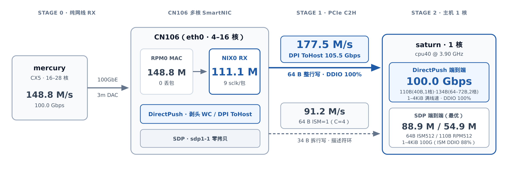

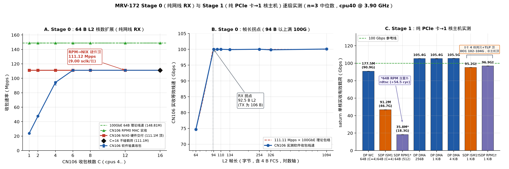

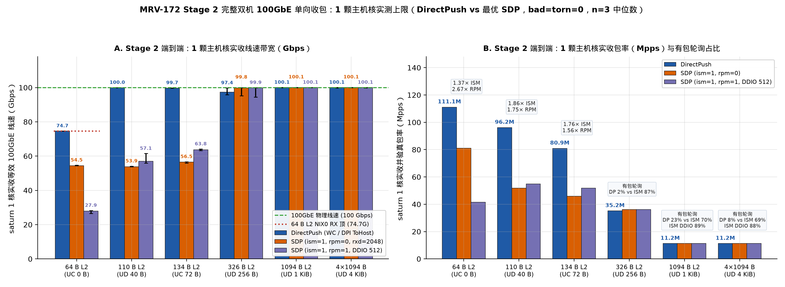

基于 [MRV-172 1核100GbE单向RX实测](https://linear.app/taooceros/issue/MRV-172)（174/174 轮全零 `bad/torn`，全链路 `segment_drops` 精确闭合、`24/24` 轮 `DirectPush` 的 `c2h_to_host_drop = 0`，经 [MRV-174 MRV-172评审](https://linear.app/taooceros/issue/MRV-174) 评审定案）：

* **Stage 0 & Stage 1 实测天花板**：
  * `mercury` 发 `64 B` L2 满 `148.81 Mpps`，`RPM0 MAC` 零丢包收齐，但 `RPM0 → NIX0` 严格钉在 **`111.11–111.12 Mpps`**（`C ≥ 8` 软件零丢，`94 B / 102 B / 110 B / 134 B / 326 B / 1094 B / 4 KiB` 全满 `99.8–100.1 Gbps` 且 `loss_free = 3/3`）。
  * Stage 1 卡→主机 1 核：`64 B PEM0 WC`（`C = 2/4/8`）达 **`177.48–177.51 Mpps`**（`90.9 Gbps`，`64.0 B/wr`，`DDIO 100.0%`）；4-VF **`DPI ToHost`** 在 `256 B / 1 KiB / 4 KiB / 4×1 KiB` 全线输出 **`105.4–105.5 Gbps`** 纯载荷（`206.0 M` 整行/s，`DDIO 100.0%`）。
* **Stage 2 完整 1 核单向 RX 端到端实测总表（`saturn` 严格 1 核 `cpu40 @ 3.90 GHz`，`n = 3` 中位数）**：

| 帧长 / 载荷（L2 含 FCS） | `1H DirectPush`（包率 / 等效线速） | `1H SDP ISM 2048` | `1H SDP RPM 512` | DirectPush 领先幅度 | 主机硬件 PMU（DP vs SDP ISM2048 / RPM512） |
| :--- | ---: | ---: | ---: | :-: | :--- |
| **`64 B` L2**（UC `0 B`） | **`111.11 Mpps` / `74.7 Gbps`** | `81.06 Mpps` (`54.5G`)；`ISM 512`: `88.86M` | `41.58 Mpps`† | **`1.37×`**（vs ISM2048） / `1.25×`（vs ISM512） | DP `DDIO 100% / sb 0.1%`（唯一丢包在 `RPM→NIX`）；†`64 B RPM` 受 `uc64` 置外 `rdtsc +54.5 cyc` 伪影拖累 |
| **`110 B` L2**（`40 B` UD, **`cpp=1`**） | **`96.16 Mpps` / `100.0 Gbps`** | `51.79 Mpps` (`53.9G`) | `54.86 Mpps` (`57.1G`) | **`1.86×`**（ISM） / **`1.75×`**（RPM） | **吃满 100GbE**；无 `rdtsc` 伪影下 `RPM 512` 反超 `ISM 2048` |
| **`134 B` L2**（`72 B` UC, **`cpp=2`**） | **`80.93 Mpps` / `99.7 Gbps`** | `45.89 Mpps` (`56.5G`) | `51.75 Mpps` (`63.8G`) | **`1.76×`**（ISM） / **`1.56×`**（RPM） | **`≥ 64 B` 全载荷满线速锚点**（`3/3` 全段零丢；`UD 64 B` 对照受 `mercury` 发顶为 `76.03M / 93.7G`） |
| **`326 B` L2**（`256 B` UD, DMA） | **`35.17 Mpps` / `97.4 Gbps`**（`rep 2` `99.8G`） | `36.07 Mpps` (`99.8G`) | `36.08 Mpps` (`99.9G`) | 逼近满线速 | `rep 0–1` 仅 4 核 `nix→sw` 微丢；`DP sb_stall 1.1%` vs `ISM 16.7%` |
| **`1094 B` L2**（`1 KiB` UD, DMA） | **`11.23 Mpps` / `100.1 Gbps`**\* | `11.23 Mpps` (`100.1G`)\* | `11.23 Mpps` (`100.1G`)\* | 同满 100GbE，主机零污染 | DP **`DDIO 100.0% / IMC 0.2G / sb 0.1%`** vs ISM2048 **`88.6% / 11.4G / 53.4%`**（RPM512 `99.9% / 0.6G / 1.3%`） |
| **`4×1094 B`**（`4 KiB` UD, DMA） | **`11.23 Mpps` / `100.1 Gbps`**\* | `11.23 Mpps` (`100.1G`)\* | `11.23 Mpps` (`100.1G`)\* | 同满 100GbE，主机零污染 | DP **`DDIO 100.0% / IMC 0.3G / sb 0.1%`** vs ISM2048 **`88.2% / 11.8G / 57.7%`**（RPM512 `99.7% / 0.6G / 1.1%`） |

> **关键边界与归因澄清（[MRV-172 1核100GbE单向RX实测](https://linear.app/taooceros/issue/MRV-172) / [MRV-174 MRV-172评审](https://linear.app/taooceros/issue/MRV-174)）**：
> * **`110 B` vs `134 B` 载荷崖壁**：单格 `RxCell` 净容上限为 `40 B`，故 `110 B`（`40 B` UD，剥头后 `cpp = 1`）吃满 `100.0 Gbps`，而 **`134 B`（`64–72 B` 载荷，`cpp = 2`，每包完整搬运 `128 B`）才是严格 `≥ 64 B` 全载荷满线速锚点**（若真 `64 B` UDP 保留独立 `24 B` C2H 包络走 `cpp = 2`，将受 `177.5 M` 行/s `PEM0 WC` 顶限停在 `~88.8 Mpps / ~92.3 Gbps`）。
> * **三项防误归因澄清**：① `100.1 Gbps`\* 含对称 `+0.09%` `mlx5` SQ 排空尾窗；② 大包主机效率严格以硬件 PMU（`DDIO / IMC wr / sb_stall`）为准，不采信受 `4 KiB` `settle_u64` 自旋失真的未加权 `busy_poll_pct`；③ `dpdk-testpmd` `58.1 Mpps` 实测系卡侧 4 核 `txonly` 顶、Stage 1 `SDP 1 KiB`（`95.2 / 96.9G`）系卡侧 4 核拷贝 + PCIe TLP 开销（`IIO1 102–104G`），均非 `saturn` 主机单核 RX 上限。

---

## 第 6 章 主动网卡突发缓冲：主机只留 `256 KiB` 热环，突发留卡 L3 / DDR5

> **本章回答**：传统被动网卡（Passive NIC）遇到突发流量只能一股脑灌进主机 `128 MiB` 大环，瞬间打穿主机 `60 MiB` LLC 和 DDIO；`CC-NIC` 与 `CEIO` 又把解决慢路径的希望寄托在 CXL 上。如果让非一致商用网卡作为 **Active Entity** 主动接管突发蓄水——主机只留 `256 KiB` 热环、突发积压留在网卡 `48 MiB` L3 与 6 通道 DDR5，按主机额度原位走同一条亚微秒快路径补推——到底值不值？

### 6.1 单变量设计（[MRV-153 主动网卡缓冲管理设计](https://linear.app/taooceros/issue/MRV-153) 架构论证 + [MRV-158 主动网卡突发缓冲实测](https://linear.app/taooceros/issue/MRV-158) 108 轮零错实测）

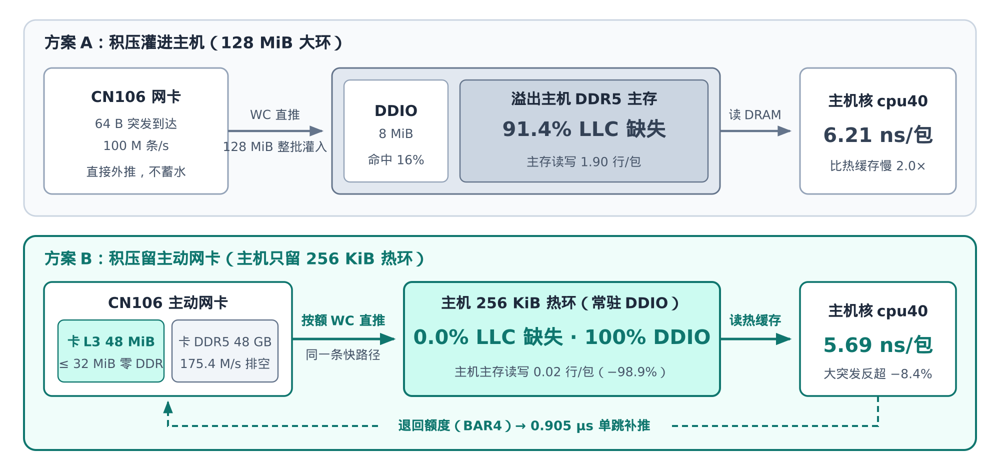

固定同一套纯 `BAR4 + PEM0 WC` 直通快路径（1 主机核 `cpu40 @ 3.90 GHz` + 1 卡核 `cpu3 @ 2.00 GHz`、`64 B` 消息、突发到达 `100 M/s`、`credit_batch = 512`、`host_poll_batch = card_push_batch = 32`、零 DSA），**只改主机接收环大小**：
* **方案 A（被动网卡）**：主机 `128 MiB` 单调大环，全部突发直接灌进主机内存；
* **方案 B（主动网卡）**：主机锁死 `256 KiB` 热环（远小于 2-way DDIO），超出部分留在主动网卡 `48 MiB` L3 / 6 通道 DDR5，主机每消费一批归还 `TAKEN` 额度，卡侧即原位走同一条 `PEM0 WC` 快路径补推（排空后队列指针复位归零）。

### 6.2 核心实测发现：零积压 `+6 ns`、主机 DRAM **`−98.90%`** 与全系统守恒对偶

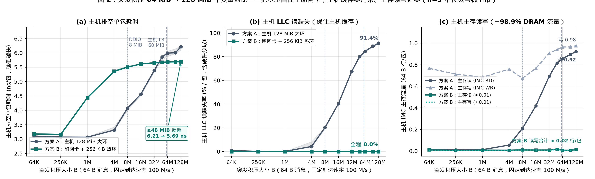

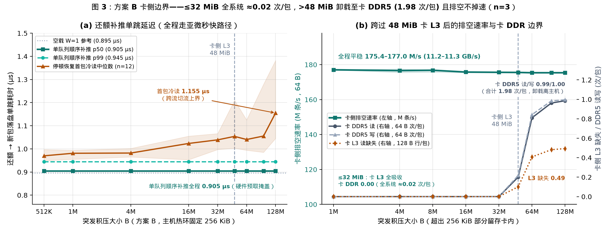

1. **零积压几乎零开销**：把额度检查做在快路径本地缓存读上，`W = 1` 往返均值仅 **`+6 ns`**（`0.8868 → 0.8928 µs`，`p50 0.885 → 0.895 µs`），`W = 32` 吞吐零退化（`13.05 → 13.30 M/s`），开额度单向推流稳跑 `176.91 M/s`（`DDIO 100.0%`）。
2. **`128 MiB` 突发下主机零缓存污染、主机 DRAM 流量暴降 `−98.90%`**：

| 单轮突发大小（4 轮累计 `512 MiB` 载荷） | 方案 A 主机 LLC 读缺失 / DDIO | 方案 B 主机 LLC 读缺失 / DDIO | 方案 A 主机 IMC 读写 | 方案 B 主机 IMC 读写 | 方案 B 卡 6 通道 DDR5 读写 | 物理分段 |
| :--- | :---: | :---: | ---: | ---: | ---: | :--- |
| **`1 MiB`** | `0.11%` / `32.2%` | `0.02%` / **`100.0%`** | `178.28 MiB` | **`3.62 MiB`** | **`0.02 MiB`** | **≤ 32 MiB**：卡 L3 全吸收，全系统 DRAM ≈ 0 |
| **`16 MiB`** | `40.28%` / `26.4%` | `0.01%` / **`100.0%`** | `302.56 MiB` | **`4.68 MiB`** | **`0.05 MiB`** | 同上 |
| **`32 MiB`** | `67.56%` / `21.3%` | `0.02%` / **`100.0%`** | `409.75 MiB` | **`3.86 MiB`** | **`0.19 MiB`** | 仍有效留在卡 L3（DDR5 ≤ 0.2 MiB） |
| **`48 MiB`** | `79.99%` / `26.2%` | `0.02%` / **`100.0%`** | `422.10 MiB` | **`6.41 MiB`** | **`100.56 MiB`** | **≥ 48 MiB 开始溢入卡 DDR5**（与代码/标签共用 48M L3） |
| **`64 MiB`** | `84.49%` / `18.2%` | `0.02%` / **`100.0%`** | `466.14 MiB` | **`3.45 MiB`** | **`423.70 MiB`** | 渐进卸载至卡 DDR5 |
| **`128 MiB`** | **`91.35%`** / `16.3%` | **`0.01%`** / **`100.0%`** | **`971.52 MiB`** | **`10.69 MiB`（`−98.90%`）** | **`1,014.41 MiB`** | **守恒对偶**：卡承接 `1.98 次/包` 对偶主机 `1.90 行/包` |

3. **还额补推不改道、跨卡 L3 排空不掉速，同时坦诚记录中等突发排空权衡**：
   * **全系统守恒对偶**：`≤ 32 MiB` 突发由卡 `48 MiB` L3 完整吸收，真正消除了全系统 DRAM 流量；`≥ 48 MiB` 开始溢入卡 6 通道 DDR5，在 `128 MiB` 档由卡 DDR5 接盘 `1,014.41 MiB`（`1.98 次/包`），与方案 A 主机 `971.52 MiB`（`1.90 行/包`）形成精确守恒对偶，等价将 `~2×` 内存带宽彻底卸载离主机。
   * **顺序还额单跳恒定亚微秒**：突发蓄水从 `512 KiB` 一路增至 `128 MiB`，顺序还额补推单跳耗时恒为 **`p50 = 0.905 µs / p99 = 0.945 µs`**（停顿恢复首包冷读均值 `0.968 → 1.165 µs`，对应多流随机切流越过 L3 时的上界）；跨过卡 L3 后卡侧排空速率依然稳在 **`175.36 M/s`（`11.22 GB/s`）**（`32 → 128 MiB` 仅 `−0.14%`）。
   * **坦诚权衡与边界**：单卡核配置下，`1–32 MiB` 中等突发时方案 B 排空慢于仍命中主机 L3 的方案 A（`4.44–5.66 vs 3.07–5.39 ns/包`，完整周期差 `+1.8% ~ +15.4%`）；到 `≥ 48 MiB` 反超（`128 MiB` 快 **`8.4%`**：`5.69 vs 6.21 ns/包`）。小突发（`64 KiB–1 MiB`）方案 A 的写回反映传统单调 RX 环扫址陈化效应（若主机换用 LIFO 池会消除此项，但 `≥ 16–32 MiB` 以上结论不变）；另若整包存放 `1500 B` 大包，需按字节缩小 `credit_batch` 或头荷分离以防热环死锁。与 `CEIO` 的结构差异在于我们的蓄水与补推**做在每条消息必经的亚微秒快路径上**，无需像 `CEIO` 那样整流改道进慢路径，也不需要 CXL 内存。

---

## 第 7 章 诚实边界、已撤回/收紧口径清单与剩余可选 Backlog 地图

### 7.1 我们明确承认的物理与架构边界（绝不硬碰）

1. **裸互连物理硬边界**：商用分立 PCIe Gen5×4（单向 `15.75 GB/s`、`64 B` 上限 `179.02 M/s`）与跨两颗分立 SoC 的控制器转换税，决定了我们**客观赢不了** `CC-NIC` 双路 Sapphire Rapids 4 条 UPI（`192 GB/s`）仿真的 `490 / 650 ns` 裸延迟或 56 核 `1.52 Gpps / 986 Gbps` 整机聚合带宽。我们真正证明的是：**同等单核与真实硬件条件下，接口收益来自直推、缓存局部性与主动蓄水，而非硬件一致性**。
2. **非一致 PCIe 无法替代的场景**：PCIe 没有 `CXL.cache` 级跨设备细粒度缓存一致性，因此做不到主机核与网卡核在共享内存池上直接执行 `LOCK CMPXCHG` 级并发共享分配器（`CC-NIC` §3.4）或细粒度共享可变状态。
3. **卡核计算成本**：`DirectPush` 与主动网卡蓄水要求卡上 ARM 核位于每条消息的数据路径上，这比纯硬件无核卸荷方案多消耗网卡自身算力（尽管在 DPU/SmartNIC 上这些 ARM 核本就存在且 `4–16` 核即可顶满单口 `100GbE`）。

### 7.2 已撤回 / 已收紧口径全量对照清单（严禁再引用旧口径）

经 [MRV-37 实验独立评审制度](https://linear.app/taooceros/issue/MRV-37) 多轮独立复算与跨模型评审，以下早期表述已全部**正式撤回或收紧**，本总报告及后续论文写作一律以右栏为准：

| 旧报告中的过时/含水分口径（已弃用） | 撤回/收紧原因 | 现行权威定案口径（唯一有效） | 依据议题 |
| :--- | :--- | :--- | :--- |
| 「相对强对照 `SDP` 实省 `2.4× / 3.24×` 核、相对默认省 `8–11×` 核；强对照 `SDP` 存在 `58.6% / 93.8%` `late_tails` 等尾自旋」 | 旧强对照 `SDP` 在 `rx_poll_mem=1` 下同步死等包尾且 RX 环 `2048` 溢出 DDIO，含约 1/3 实现水分 | **全面改用公平异步 `SDP` 四层账本**：`rx_poll_tail_off=16` 将 `late_tails` 清零至 `0.00%`（砍 `−459 cyc`），总倍率 **`1.54–2.07×`**（`B=1`）/ `1.67–1.98×`（`B=8`），扣空轮询与双行尾税后 DPDK 栈税 `[推算] 1.26–1.53×`；明确区分 **`1–4 KiB` 软件栈税** vs **`64 B` 真硬件优势** | [MRV-166 异步等尾公平SDP核账本](https://linear.app/taooceros/issue/MRV-166)、[MRV-167 MRV-166评审](https://linear.app/taooceros/issue/MRV-167) |
| 「引入卡直驱主机 Intel DSA 搬运大包」 | 引入特殊 CPU 加速器会削弱「纯商用 PCIe 网卡通用方案」论点 | **彻底移除 Intel DSA**，全套实验与论文统一采用商用网卡原生 `DPI DMA`（早期 DSA 结果仅归档于 [MRV-95 卡直驱DSA归档](https://linear.app/taooceros/issue/MRV-95) / [MRV-114 DSA反向P2P瓶颈归档](https://linear.app/taooceros/issue/MRV-114)） | [MRV-120 论文大纲与零DSA定案](https://linear.app/taooceros/issue/MRV-120) |
| 「双机 `100GbE` `DirectPush` 卡内往返固定为 `1.31 µs`（端到端 `5.96 µs`）」 | 当时受 `cnxk` PMD 空轮询 `578.5 ns` `LDADDA` 量化阶梯拖累 | 启用 `cq_ctx->caching = 1` + `ldar` 窥探后空轮询降 `118×` 至 `4.89 ns`，真实双机主机增量重回 **`0.935 µs < 1 µs`**，端到端降至 **`5.285 µs`**（探索臂 `--cqe-direct` `4.755 µs` 标明四项风险） | [MRV-154 双机+0.41µs与LDADDA定位](https://linear.app/taooceros/issue/MRV-154)、[MRV-161 缓存CQE窥探恢复亚微秒](https://linear.app/taooceros/issue/MRV-161) |
| 「主机纯信用流控可在 `20 M/s` 下把 `p99` 压进 `≤ 2 µs`」 | 存在 `0.58 µs + W_credit × 77 ns` 与利特尔下界夹死的 `[18, 25]` 算术缺口 | 收紧为：**主机信用将 `p99` 压降 `6–64×`（`20 M/s` 泊松最优 `7.01 µs`）并清零 CHA 倒灌**；`≤ 2 µs` 纯主机安全区为单卡核 `≤ 13.5 M/s`、4 卡核 `≤ 10 M/s` | [MRV-115 主机在途信用整形](https://linear.app/taooceros/issue/MRV-115)、[MRV-123 恢复MAX_DRAIN与信用边界](https://linear.app/taooceros/issue/MRV-123) |
| 「入向桥拥塞像多核 Spinlock / 一致性风暴，可用 Flat Combining / Ticket 治理」 | 物理原发点是单写单读踩写前沿冲撞，非多核抢锁，且主机核无争用 | 弃用泛化 Spinlock 包装；精确定位为 **单写单读前沿冲撞触发卡内单次 IO 嗅探串行**，演进方向聚焦读端 **FastForward Temporal Slipping / 忙批门控** + 写端 **BBR-over-PCIe 在线控窗** | [MRV-173 读写冲撞与在线控窗分析](https://linear.app/taooceros/issue/MRV-173) |
| 「突发 `≤ 48 MiB` 全由卡 L3 吸收」 | 原始日志 `48 MiB` 档卡 DDR5 已产生 `100.56 MiB` 流量（与代码/标签争用物理 48M L3） | 精确收紧为：**`≤ 32 MiB` 有效全留卡 L3（卡 DDR5 `≤ 0.19 MiB`），自 `48 MiB` 起开始溢入卡 6 通道 DDR5**，至 `128 MiB` 达 `1,014.41 MiB` 完整守恒对偶 | [MRV-158 主动网卡突发缓冲实测](https://linear.app/taooceros/issue/MRV-158) |
| 「1 核 TX/RX 小大包全部打满 `100 Gbps`；`64 B SDP RPM` RX 仅 `41.6 Mpps` 且 `testpmd` 上限 `58.1 Mpps`」 | TX `1–4 KiB` 受 `DPI FromHost` 读限于 `94.0–96.5G`；RX `110 B` 为 `40 B` UD；`64 B RPM` 含 `+54.5 cyc` `rdtsc` 伪影、`testpmd` 为卡发顶 | 严格分项陈述：**TX 小包 `110/134/326 B` 满 `99.7–99.9G`、大包 `94.0–96.5G`**；**RX `110 B`（`40 B` UD, `cpp=1`）`100.0G`、`134 B`（`≥ 64 B` 全载荷锚点, `cpp=2`）`99.7G`、`1–4 KiB` `100.1G`**；大包效率以硬件 PMU 为准；标清 `rdtsc` 与卡发伪影 | [MRV-155 1核100GbE单向TX与双向](https://linear.app/taooceros/issue/MRV-155)、[MRV-163 独立SMQ消回落与100M顶](https://linear.app/taooceros/issue/MRV-163)、[MRV-172 1核100GbE单向RX实测](https://linear.app/taooceros/issue/MRV-172) |
| 早期不规范中文术语（直译 `fence` 或以含糊状态词代指拥塞） | 不符合硬件工程习惯或掩盖真实物理成因（[MRV-159 术语规范](https://linear.app/taooceros/issue/MRV-159) / [MRV-75 入向桥串行定位](https://linear.app/taooceros/issue/MRV-75)） | 统一保留英文 `fence` / `SFENCE`，并直接写明具体物理成因（`PEM0 / IOBN` 入向桥串行拥塞） | [MRV-159 术语规范](https://linear.app/taooceros/issue/MRV-159) |

### 7.3 剩余可选 Backlog 地图（全部非论文阻塞项，按需选做）

论文核心论点所需的全部 22 项硬件实测均已完成并过审；以下 7 项留在 `Backlog`，均为高价值的 Camera-Ready 深化或后续专题方向：

| 议题 | 所属章节 | 一句话研究问题（单变量） | 优先级建议 |
| :--- | :---: | :--- | :---: |
| [MRV-143 卡侧忙批门控自适应退避](https://linear.app/taooceros/issue/MRV-143) | 第 3 章 | 固定 `W_credit=48`，仅改卡侧忙批退避阈值 `K_busy ∈ {∞, 1, 4, 8}`，能否同时保住 `~0.9 µs` 轻载并把 `20 M/s` 泊松 `p99` 压进 `≤ 2.5 µs`？ | **高**（最直接打破 `[18, 25]` 缺口） |
| [MRV-165 并发业务缓存保护 + LIFO 池 + 多卡核补推](https://linear.app/taooceros/issue/MRV-165) | 第 6 章 | 同 Socket 并发 `16–32 MiB` 缓存敏感 KV 业务下，主动网卡留存对比主机单调大环与 LIFO 池能救回多少业务 `p99`，多卡核能否前移排空交叉点？ | **高**（补齐主动网卡真实业务收益闭环） |
| [MRV-170 `--cqe-direct` 零 LDADDA 生产边界验真](https://linear.app/taooceros/issue/MRV-170) | 第 5 章 | 在多段大包、错包/非 RX CQE 与满环回绕压测下，零 `LDADDA` 纯缓存直取 CQE 能否安全替代按需 `LDADDA`（将 `4.755 µs` 转为生产方案）？ | **中**（工程落地前置验证） |
| [MRV-147 滑窗流水消除 4 核整窗锁步](https://linear.app/taooceros/issue/MRV-147) | 第 3 章 | 将卡侧信用回写移入排空循环实现滑窗流水，能否突破 `33.5 M 行/s` 锁步顶冲上 `40+ M 行/s` 并消除 `71%` 信用空转？ | **中**（纯软件流水优化） |
| [MRV-139 多 GiB KV 池与 4 KiB 普通页 IOTLB 扫描](https://linear.app/taooceros/issue/MRV-139) | 第 4 章 | 将随机 KV 池扩至 `512 MiB–3 GiB`（越过 IOTLB）并对照 `4 KiB` 普通页，检验 `DPI DMA` 退化是否保持 `< 5%`？ | **中**（补齐大内存池边界） |
| [MRV-146 真实 `2368 B` 双行 `mbuf` 池卡侧退避](https://linear.app/taooceros/issue/MRV-146) | 第 2 章 | 固定 `W=64` 下，忙批门控退避能否在 `2368 B` 双行乱序留存池把满载 `p50` 压进 `< 3 µs` 并保住 `0.9 µs` 轻载？ | **低**（细化真实 `mbuf` 延迟） |
| [MRV-142 `WC4 + 128 B + 1.8 µs` 大窗扩展](https://linear.app/taooceros/issue/MRV-142) | 第 3 章 | 扩窗 `W ∈ {64, 128, 256, 512}` 检验单主机核闭环能否冲上 `45–50 M/s` 或因相位发散重入拥塞？ | **低**（机理边界补充） |
| *(方向提案，来自 [MRV-173 读写冲撞与在线控窗分析](https://linear.app/taooceros/issue/MRV-173))* | 第 3 章 | **BBR-over-PCIe 在线信用控窗**：在突发 `4 KiB` DMA 启停干扰下，验证按 `Δwire_RTT / Δinflight` 斜率自动在 `80 ↔ 32` 行追踪 `C_line` | **高**（可单独立项回应静态阈值质疑） |

---

*报告整理与全量日志复算日期：2026-11-24（对应 Linear 总整理单 [MRV-175 CC-NIC终版总报告整理](https://linear.app/taooceros/issue/MRV-175)，全量原始日志位于本仓库 `logs/mrv*/runs*.jsonl`，总览成绩单脚本位于 `docs/figures/mrv-175-scorecard.py`）。*
